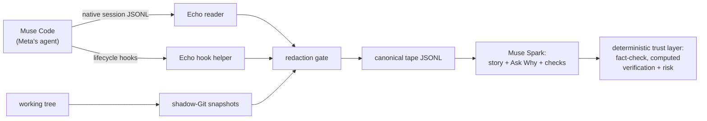

# Echo

One minute after opening a coding-agent session, say what shipped, where it differs from what you asked, and what could bite you.

Built for the Meta Global AI Developer Hackathon 2026 (Oct 27 to Nov 4), Indie Developer track, Build for Your World. History starts Oct 27 (`4ce366b`). Everything in the demo path is new work from the event.

## The problem

Developers now approve agent-written diffs they haven't fully read. Some numbers behind that:

- METR (2025, 16 experienced devs, 246 issues): with AI help, devs took 19% longer and believed they were 20% faster.
- Stack Overflow 2025 (33,662 responses): 46% distrust AI accuracy; 66% call the output "almost right, but not quite."
- Perry et al. (ACM CCS 2023): assisted writers produced insecure code more often on 4 of 5 tasks, and believed it was secure.

None of that measures Echo. The submission says so. But it points at the actual gap. Generation stopped being the bottleneck. Trust is what slows teams down now. A diff shows what changed. Nothing shows what shipped versus what you asked, in plain terms, in a minute. And nothing checks whether you understood the risky parts.

## Watch it

Three minutes, all on screen:

- Demo video: TODO (link lands with the cut)
- Hosted read-only demo: TODO (link lands with the deploy; see `docs/DEPLOY.md`)
- Submission entry: TODO

The video opens the inbox, reads the newest session's story (short version, ask-vs-result, behaviour cards), opens one card (before and now, an inline evidence slice, what checked it), runs the calibration check and gets one wrong while Certain, then asks something the tape can't answer and gets refused. No scores, no gates. A picture of calibration, then back to the inbox.

## How it works

Echo records a normal interactive Muse Code session and turns the finished tape into a one-minute story plus a calibration check on the risky changes.



Muse Code (native session logs, lifecycle hooks) and Muse Spark (drafting, grounded answers, check generation) are Meta's. Everything else is mine, built in this repo: the recorder, the tape format, shadow-Git capture, the deterministic trust layer (claim validation with one regeneration then a gap line, computed observed-only verification, blast radius times mental-model risk), evidence-grounded Ask Why with refusal, calibration checks v2, engagement tracking, the redaction gate.

"Just a log viewer" is the obvious dismissal. Four things answer it. The refusal: "not on the tape." The Detours: reverted and failed attempts a final diff can't show. Verification that is computed, never asserted by the model. Checks aimed at the risky cards you never opened.

## Run it

Needs Node 24 and pnpm 12.

```sh
pnpm install
pnpm dev
```

That starts the daemon on 127.0.0.1:4783 and Vite on :5173.

Keys come from `META_API_KEY` and `BASETEN_API_KEY` (see `.env.example`). Never commit real keys; `.env.local` is gitignored. With the model off, story generation falls back to a deterministic skeleton, so the loop is explorable without spending credits.

I'm the first user, so the first sessions recorded are mine. The demo uses my own repos plus a synthetic secret.

## Honest limits

- No Windows support, no installer, no team views, no retakes, no export or sharing in v1.

## Layout

```text
apps/
  cli/                     @echo/cli, bin: echo-cli
  server/                  @echo/server, bin: echo-daemon
  web/                     @echo/web, Vite React SPA
packages/
  contracts/               Zod schemas, API types, tape types, error codes
  core/                    IDs, time, result types, domain constants
  config/                  paths, config load/validate, secrets lookup
  db/                      Drizzle schema, migrations, repositories
  tape/                    tape writer/reader, validation, repair, merge
  capture/                 adapter interface, orchestrator, spool, reconciliation
  capture-muse/            Muse hook translator, native-log reader, export reconciler
  capture-opencode/        OpenCode V2 plugin and adapter (optional)
  snapshots/               shadow Git repo, manifest, snapshotter, blame queries
  story/                   deterministic facts, validator, skeleton, narration prompt
  graph/                   central code index (files/symbols/edges) + parsers
  redaction/               detectors, placeholders, preview, policy
  retrieval/               evidence bundle builder, FTS ranking, token budget
  model/                   provider interface, Meta/Baseten clients, structured output, cache
  checks/                  selection, generation, rubric grading, picture mapping (no scores)
  sandbox/                 runner interface, container/bwrap/WASM backends
  notifier/                desktop notification, browser open
  fixtures/                fixture builders used by tests and evals
```

## Design decisions

Ground truth lives in the repo:

- [`docs/echo-spec.md`](./docs/echo-spec.md) — product spec. Where spec and architecture disagree on product intent, the spec wins.
- [`docs/ARCHITECTURE.md`](./docs/ARCHITECTURE.md) — technical mechanism. Each section maps to the packages above; §23 is the build order.
- [`docs/adr`](./docs/adr) — accepted architecture decisions.
- [`docs/spikes`](./docs/spikes) — real-session notes and observed Muse schemas.

## License

MIT — see [LICENSE](./LICENSE).
