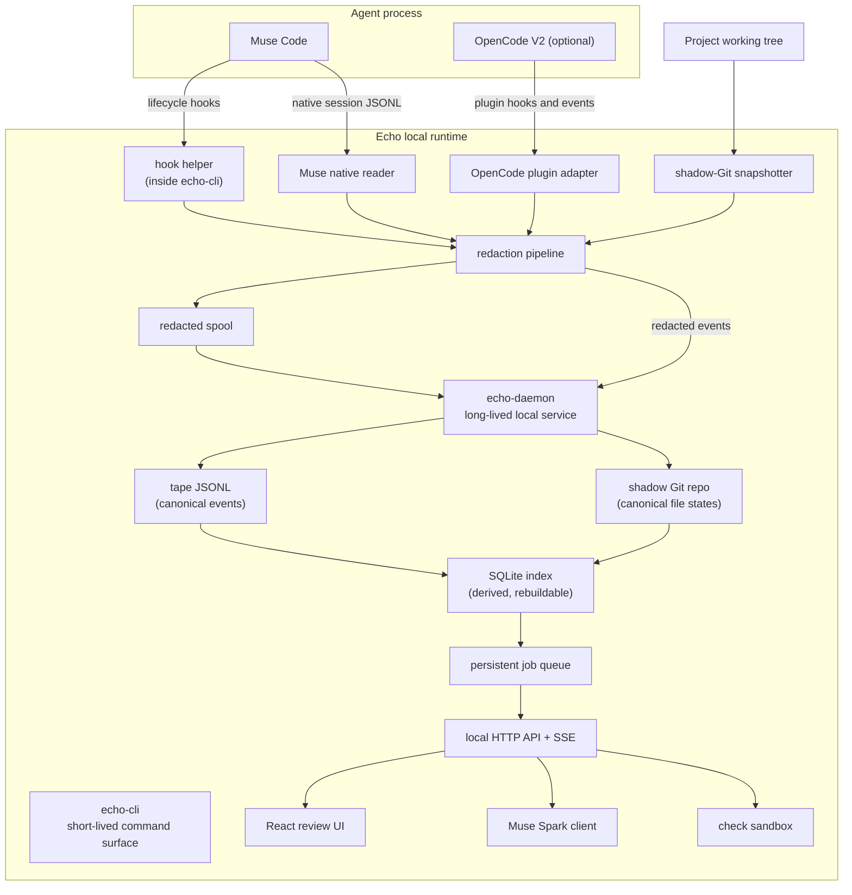
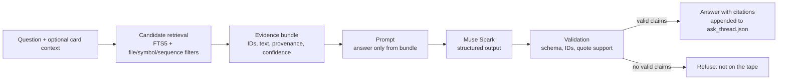

# Echo — Architecture

Status: draft for build, October 27, 2026. Architecture only; this document does not scaffold code.

Canonical product spec: [`echo-spec.md`](./echo-spec.md) (v3). Where this document and the spec disagree on product intent, the spec wins. Where they disagree on technical mechanism, this document is the current default until a spike or ADR replaces it.

The target is one narrow path that works end to end: record a normal interactive Muse Code session, review its story locally, answer questions only from captured evidence, and verify understanding by running code. Everything else is either in service of that path or explicitly cut.

**At a glance**

- **Runtime:** one local daemon, one thin CLI, one browser UI. The daemon owns canonical writes and long-running work.
- **Capture:** Muse native session JSONL + lifecycle hooks + independent shadow-Git snapshots. No PTY authority.
- **Storage:** append-only redacted JSONL tape + shadow Git commits as the source of truth; SQLite as a rebuildable index.
- **Review:** story cards with inline code, persisted ask thread with refusal, checks v2 with a picture (no scores).
- **Delivery:** a local app for the demo and a read-only hosted demo built from the same code and a baked tape.

**How to read this:** sections 1–4 are the shape and stack; 5–12 are capture, storage, redaction and evidence mapping; 13–16 are the review, Q&A, checks and project view; 17–23 are the API/security, hosted demo, CLI, failure behavior, performance, tests and build order; 24–27 are the verification log, spec discrepancies, decisions and spikes; 28–29 are boundaries and references.

---

## 1. Constraints that shape the design

| Constraint | Architectural consequence |
| --- | --- |
| Solo build, public repo, building period Oct 27–Nov 4 | Boring, composable technology. No service dependencies that need an account before the first commit. One daemon, one SQLite file, one local web app. |
| Muse Code is the primary demo subject | The Muse reader is the first and only core capture adapter. It gets the real-session spike, the schema pinning and the capture-quality work. |
| OpenCode V2 is the documented second path | It is a separate, optional adapter package. It must not complicate the core daemon or weaken Muse guarantees. |
| Normal interactive sessions, not a headless SDK | Capture from native session records plus lifecycle hooks. No PTY parsing as the authority. |
| Evidence, not intent | Every answer is tied to an event or snapshot. Agent-stated text and observed effects are labeled separately. Unsupported intent claims are refused. |
| Redaction before storage and before model calls | Redaction sits in front of the tape writer, the shadow Git object store, the spool, the database and the model client. Raw native Muse logs are disclosed as a separate surface. |
| Execution decides what is true in the proof half | Checks are generated by the model but accepted only after a sandbox run of the reference answer. A check that does not clear the gate is never shown. |
| Local-first, but local stops at the model call | The UI and storage are local. Retrieved, redacted tape segments go to a hosted model. The submission must say so. |
| Hosted read-only demo | The same web app runs in a `demo` profile against a baked tape. No ingest, no filesystem browsing, no arbitrary code execution, spending caps. |
| No Windows support in scope | Target Linux and macOS. Windows remains documented as out of scope. |
| Three-minute demo, tight cut line | The story page, refusal and one checks-v2 question are the demo. Project graph/overlay and extra readers follow the cut line. |

**Non-goals:** a universal terminal recorder, a PTY-authoritative transcript, complete private reasoning, lossless filesystem history, a general chat product, an IDE plugin, cloud sync, login, team accounts, Windows, installer packaging, or a second agent reader in the core path.

---

## 2. System at a glance



### Processes

| Process | Lifetime | Responsibility |
| --- | --- | --- |
| `echo-cli` | Short-lived | User commands: `record`, `replay`, `import`, `daemon`, `hook`, `doctor`, `enable`/`disable`, `demo`. Starts the daemon if needed. The hook subcommand is deliberately tiny and fast. |
| `echo-daemon` | Long-lived, one per user per machine | Owns all writes. Runs the HTTP API, session discovery, native-log tailers, snapshotter, redaction, indexer, job queue, model calls and sandbox jobs. |
| `echo-web` | Static assets loaded in a browser | React SPA. No secrets in the bundle. Talks only to the loopback API. Served by the daemon in production; Vite dev server in development. |

The daemon is the only writer to canonical Echo-owned storage. Hooks and the CLI never open SQLite for writing and never append directly to a session tape. They send already-redacted events to the daemon, or to a bounded redacted spool that the daemon drains. The spool is a transport buffer, not a second source of truth. This keeps the concurrency model simple and makes redaction a single enforced boundary.

### Why daemon-first

- Hooks must return in milliseconds. A daemon can acknowledge quickly and do snapshotting, indexing and model work later.
- Session discovery and native-log tailing are long-running watchers; they do not fit a CLI that exits with the agent.
- The review UI needs live updates while the session is still running and after it ends.
- Model calls, sandbox runs and graph builds must not block the agent or the UI.
- One daemon can serve several sessions, projects and browser tabs, and can recover its queue after a crash.

---

## 3. Architectural principles

1. **Daemon owns state.** The CLI and hooks are stateless producers. Storage writes are serialized through the daemon.
2. **Native records first.** Muse's structured session records are the authority for what was requested and what came back. Hooks provide timing and lifecycle; files provide what actually changed. Hooks are not a transcript.
3. **Redaction before persistence.** No raw secret should reach the tape, shadow Git object store, SQLite, spool, cache, logs or model request. If redaction fails, the event is dropped with a diagnostic rather than stored raw.
4. **Canonical tape, rebuildable index.** The append-only JSONL tape and the shadow Git commits are the source of truth. SQLite's review tables are a derived index that can be rebuilt from them; its job/settings tables are operational state. If the review index is corrupt, `echo-cli index rebuild` must recover the review experience.
5. **Evidence has a type.** Observed actions, observed file effects and agent-stated text are distinct. Inferred intent is never rendered as the agent's reasoning.
6. **Gaps are data.** Missing snapshots, sequence gaps, checkpoint trimming, schema drift and failed hooks become visible diagnostics, not silent omissions.
7. **Adapters translate, never leak.** Muse and OpenCode adapters emit the same canonical event envelope. Agent-specific quirks stay inside the adapter package.
8. **Local by default.** No telemetry, no cloud sync, no remote storage. The only outbound request is the model call, and it is explicit, redacted and metered.
9. **Boring components, sharp boundaries.** SQLite, Git, Fastify, React and Node. The novel work is capture correlation, evidence linking and the check gate, not infrastructure.
10. **Honest degradation.** A degraded capture is labeled as degraded. A missing sandbox disables checks rather than silently grading in-process. A missing model returns an error, not an invented answer.

---

## 4. Proposed repository layout

A pnpm workspace. Package scope `@echo/*` is internal and `private: true`; if the project is ever published, the scope can change without touching the binary name.

```text
echo/
  apps/
    cli/                     # @echo/cli, bin: echo-cli
    server/                  # @echo/server, bin: echo-daemon
    web/                     # @echo/web, Vite React SPA
  packages/
    contracts/               # Zod schemas, API types, tape types, error codes
    core/                    # IDs, time, result types, domain constants
    config/                  # env-paths, config load/validate, secrets lookup
    db/                      # Drizzle schema, migrations, repositories
    tape/                    # tape writer/reader, validation, repair, merge
    capture/                 # adapter interface, orchestrator, spool, reconciliation
    capture-muse/            # Muse hook translator, native-log reader, export reconciler
    capture-opencode/        # OpenCode V2 plugin and adapter (optional)
    snapshots/               # shadow Git repo, manifest, snapshotter, blame queries
    redaction/               # detectors, placeholders, preview, policy
    retrieval/               # evidence bundle builder, FTS ranking, token budget
    story/                   # deterministic facts, story validator, skeleton fallback
    model/                   # provider interface, Meta/Baseten clients, structured output, cache
    checks/                  # checks v2: selection, generation, rubric grading, picture mapping (no Brier in web responses)
    sandbox/                 # runner interface, container/bwrap/WASM backends
    graph/                   # TypeScript import graph and project overlay
    notifier/                # desktop notification, browser open (future mechanism; not wired in v1)
    fixtures/                # fixture builders used by tests and evals
  eval/                      # section 9 metric scripts and hand-label files
  fixtures/                  # synthetic repos, fake Muse logs, baked tapes
  docs/
    adr/                     # architecture decision records
    spikes/                  # real-session notes and captured schemas
  package.json
  pnpm-workspace.yaml
  tsconfig.base.json
  biome.json
```

Dependency direction:

```text
contracts <- core <- config, db, tape
contracts <- redaction, snapshots, capture, model, sandbox, story
capture + tape + db + redaction + snapshots <- capture-muse, capture-opencode
all of the above <- server
contracts <- web (types and fetch client only)
cli <- server client + config + contracts
```

The web app must not import server code or Node built-ins. The adapters must not import the server. The model package must not import the database; the server composes them. Card/hunk IDs are defined in `@echo/contracts` and shared end to end: the canonical card ID is `h_`-prefixed (section 12); the web never invents `path:hunkIndex` IDs. Engagement events go through the API; the web still imports contracts only.

### Runtime stack

| Concern | Choice | Why |
| --- | --- | --- |
| Runtime | Node 24 LTS | Native `fetch`, modern ESM, good child-process support, matches the OpenCode plugin ecosystem. |
| Package manager | pnpm workspaces | Fast, strict, good monorepo ergonomics. |
| Language | TypeScript, strict | Shared contracts across server, web, CLI and plugin. |
| HTTP | Fastify | Small, fast, schema-friendly, good SSE support. |
| Validation | Zod | One schema source for API, tape and model output validation. |
| Database | SQLite via `better-sqlite3` + Drizzle | Single-file local index, synchronous reads, easy backup. Fall back to Node's built-in `node:sqlite` if native builds are a problem. |
| Migrations | Drizzle Kit + raw SQL for FTS5 | Typed schema plus FTS5 virtual tables that Drizzle does not model. |
| File watching | chokidar | Cross-platform recursive watch with debounce. |
| Git | Git CLI, invoked with an isolated environment | Shadow snapshots, diffs, blame and cat-file. No libgit2 native dependency. |
| UI | React + Vite + Tailwind + shadcn/ui | Fast local build, accessible primitives, no design system from scratch. |
| Data fetching | TanStack Query | Cache, invalidation and SSE-driven refetch. |
| UI state | Zustand | Ephemeral playback, selection and panel state only. |
| Routing | React Router | Deep links to projects, sessions, hunks and checks. |
| Diff | `@git-diff-view/react` + Shiki | Split/unified diff, syntax highlighting, hunk-level interaction. |
| Project graph | `@xyflow/react` | Pan/zoom node graph with custom file nodes. |
| Attempt tree | `d3-hierarchy` + SVG | Deterministic tree layout, easier to label than a free-form graph. |
| Charts | Recharts | Calibration and session summary charts. |
| TS analysis | `ts-morph` | Import graph and symbol extraction using the TypeScript compiler. |
| Bundling snippets | esbuild | TS→JS and self-contained check harnesses. |
| Sandbox | Docker/Podman, `bwrap` fallback, QuickJS/WASM for demo | Layered isolation with an honest capability ladder. |
| Tests | Vitest, Playwright | Unit/integration and browser E2E. |
| Logging | pino | Structured local logs with redaction. |
| CLI | commander + execa | Small command surface and reliable child-process handling. |
| Notifications | node-notifier, with native fallbacks | Future mechanism; not wired in v1 — no popup is sent. |

No Electron, no Tauri, no installer in the hackathon build. The browser is the UI.

---

## 5. Runtime and process model

### Data and config locations

Use `env-paths` semantics, with explicit overrides for tests and the demo.

```text
$XDG_DATA_HOME/echo/                  # default ~/.local/share/echo
  daemon.json                         # pid, port, started_at, version (0600)
  echo.sqlite                         # derived index
  echo.sqlite-wal
  projects/<project_id>/
    project.json                      # root, remote, display name
    shadow.git/                       # bare shadow repository
    sessions/<session_id>/
      tape.jsonl                      # canonical redacted events
      meta.json                       # session metadata, capture quality
      diagnostics.jsonl               # capture gaps and adapter notes
      artifacts/
        graph.json
        story.json                    # generated story payload (versioned, watermark-stamped)
        checks_v2.json                # checks v2 state machine + answers (versioned, watermark-stamped)
        ask_thread.json               # persisted ask thread (versioned, watermark-stamped)
        report.json                   # legacy summary artifact; story page supersedes it for review
        checks/<check_id>.json        # legacy per-check files; superseded by checks_v2.json
  spool/<session_id>/                 # redacted hook events awaiting ingest
  cache/model/                        # content-addressed model responses
  logs/echo.log
  tmp/

$XDG_CONFIG_HOME/echo/config.json     # default ~/.config/echo/config.json
```

Directories are `0700`; files are `0600`. API keys are read from environment variables (`META_API_KEY`, `BASETEN_API_KEY`) and are never written to `config.json` or the database. A future keychain integration is out of scope.

### Daemon lifecycle

1. `echo-cli` checks `daemon.json` and calls `GET /api/health`.
2. If no healthy daemon exists, the CLI spawns `echo-daemon` detached, waits for health, and writes discovery data.
3. The daemon acquires an exclusive lock (`daemon.lock`) to enforce one instance per user. A stale lock is detected by PID and health check.
4. On start: open SQLite, run migrations, recover `running` jobs whose lease expired, rebuild any missing FTS rows, start project watchers for enabled projects, start the HTTP server on `127.0.0.1` with an ephemeral port (or a configured port).
5. On shutdown: stop accepting jobs, finish or release in-flight jobs, flush the tape writer, close SQLite, remove the lock.

The daemon binds loopback only. It never binds `0.0.0.0` in local mode. The hosted demo is a separate deployment profile, not a flag that flips the local daemon open.

### Recording sequence

```mermaid
sequenceDiagram
  participant U as User
  participant CLI as echo-cli
  participant D as echo-daemon
  participant M as Muse Code
  participant H as Muse hooks
  participant R as native reader
  participant S as snapshotter

  U->>CLI: echo-cli record -- muse
  CLI->>D: ensure running; enable project
  CLI->>D: baseline snapshot request
  D->>S: baseline commit
  CLI->>M: spawn muse (stdio inherited)
  M->>H: SessionStart
  H->>D: redacted lifecycle event
  D->>R: attach session tailer
  M->>R: append session.jsonl
  R->>D: redacted native events
  M->>H: PreToolUse / PostToolUse / PostToolBatch
  H->>D: redacted tool events
  D->>S: pre/post/batch snapshots (best effort)
  M->>H: SessionEnd
  H->>D: session end
  D->>S: final snapshot + reconciliation
  D->>D: index, analysis jobs
  CLI->>U: print review URL
```

The CLI wrapper does not parse the terminal. It exists to start the daemon, arm the project, establish a baseline before the agent runs, pass through signals, and print the review URL when the child exits. If hooks fail entirely, the wrapper still knows the child exited and can ask the daemon to finalize by session ID or by the most recent session in the project.

### Background mode

The product should also work when the user starts Muse normally, without `echo-cli record`. That is the “runs in the background, listens to agent sessions” requirement.

- `echo-cli enable [path]` adds a repository to the capture allowlist.
- `echo-cli disable [path]` removes it and stops capturing new sessions there.
- Hooks are installed once in the user's Muse settings, with an Echo marker. They fire for every Muse session, but the hook helper drops events whose working directory is not under an enabled project. The check is by canonical repo root, not by substring.
- If a hook payload does not contain a usable working directory, the helper writes an `unattributed` spool entry with no content and a diagnostic. It does not guess a project.
- The daemon also watches the Muse sessions directory for enabled projects, so a missed hook does not lose the native record. The reader attaches when it sees a new session for an enabled root.
- `echo-cli pause` temporarily disables all capture without uninstalling hooks.

This makes capture opt-in per repository while keeping the daemon always available. The demo enables only the synthetic demo repo.

### Finalization

Finalization is a job, not a single hook callback. It runs after `SessionEnd`, or after the wrapper observes the child exit, whichever comes first, and is idempotent.

1. Wait for the native log to become quiescent: no size change for a short window (default 1.5 s), with a hard cap.
2. Drain the session spool.
3. Run a final snapshot after filesystem quiescence.
4. If Muse export is available and the installed build supports `--redacted`, export to a private temp directory, stream it through redaction, reconcile it with the live tape, and delete the temp file.
5. Mark `capture_quality` and write diagnostics.
6. Enqueue indexing, hunk/attempt building, optional graph rebuild, story generation (`generate_story`), optional check preparation and the report.
7. Mark `story.ready`: the inbox row updates and SSE notifies the open UI. No desktop notification is sent in v1 (spec: notifications are out of v1).

Story generation is a finalization job, not inline UI work. It is idempotent and keyed by the tape watermark: `(event_count, sha256 of the redacted tape)`. New tape activity past the stored watermark marks the stored story stale, triggers regeneration, and resets the session check status (section 6).

The daemon never deletes the live tape on a failed export. It keeps the live evidence and records the export failure.

### Persistent job queue

A `jobs` table with `id`, `type`, `payload_json`, `status`, `priority`, `run_after`, `attempts`, `lease_until`, `last_error`, `created_at`, `updated_at`.

- Types: `finalize_session`, `reconcile_export`, `index_session`, `build_hunks`, `build_attempts`, `build_graph`, `generate_story`, `generate_checks`, `generate_report`, `notify`, `gc`.
- One worker loop in the daemon, concurrency 2 for I/O jobs, 1 for sandbox jobs. A per-project snapshot mutex prevents two sessions from writing shadow commits at the same time.
- Jobs are idempotent and keyed by `(type, session_id, input_hash)` so a retry does not duplicate rows.
- A crashed `running` job is requeued after its lease expires.
- The `notify` job type and `packages/notifier` exist as a future mechanism; v1 never enqueues `notify` and sends no desktop notifications.
- The queue is deliberately not a general workflow engine. It exists so a model call or a sandbox run cannot block ingest or the UI.

---

## 6. Storage model

### Three stores, three jobs

| Store | Role | Rebuildable? |
| --- | --- | --- |
| Tape JSONL (`tape.jsonl`) | Canonical redacted event stream: prompts, model calls, tool requests/results, approvals, snapshots, diagnostics, review actions. | No; it is the primary record. Back it up. |
| Shadow Git (`shadow.git`) | Canonical redacted file states as commits, with diffs and blame. | No; it is the primary file record. Back it up. |
| SQLite (`echo.sqlite`) | Query index for review data plus operational state: projects, sessions, events, snapshots, hunks, evidence links, checks, attempts, engagement, model ledger, jobs and settings. | Review data: yes, from tape + shadow Git + artifacts. Jobs/settings: no, and they do not need to be. |

Artifacts (`graph.json`, `story.json`, `checks_v2.json`, `ask_thread.json`, `report.json`) are derived and can be regenerated. They are stored as versioned JSON files under the session dir so they can be inspected and exported without the database. Each generated payload is stamped with the tape watermark it was built from (`tape_event_count`, `tape_sha256`) plus a generator version (`generator: story-vX / checks-vX / ask-vX`).

### Persistence decision (story-first)

Recorded Oct 28, 2026: the database currently has 5 tables (`projects`, `sessions`, `events`, `snapshots`, `snapshot_files`) while the table contract below assumes more. Going forward:

- SQLite holds list-queryable state only: session check status and engagement events (plus the existing projects/sessions/events/snapshots/snapshot_files, hunks/attempts/evidence index, model ledger, diagnostics, jobs, settings).
- Generated payloads live as versioned JSON artifacts under the session dir: `story.json`, `checks_v2.json`, `ask_thread.json`. SQLite never duplicates their full payloads; list views read status columns/artifact headers, detail views read the artifact file.
- Session check status is stored on `sessions.check_status` with values `not_checked` / `checked` / `skipped`, kept consistent with the `checks_v2.json` state machine (`offered` / `in_progress` / `completed` / `skipped`, with resumable answers). `not_checked` is the initial state; `checked` requires a completed check set; `skipped` is an explicit user skip. "No check needed" for no-change sessions is a derived display state in the UI, not a stored status value.
- Every artifact write passes the redaction gate before the file is written. A redaction failure drops the content and records a content-free diagnostic; no partial raw artifact is kept.

### SQLite tables

The exact DDL belongs in `packages/db/migrations`. This is the contract the rest of the architecture relies on.

| Table | Key columns | Purpose |
| --- | --- | --- |
| `schema_migrations` | `version`, `applied_at` | Migration tracking. |
| `projects` | `id`, `root_path`, `canonical_root`, `remote_url`, `name`, `created_at`, `updated_at`, `settings_json` | One row per repository. |
| `sessions` | `id`, `project_id`, `agent`, `agent_version`, `source_path`, `started_at`, `ended_at`, `status`, `check_status`, `tape_path`, `base_commit`, `final_commit`, `user_head`, `capture_quality`, `metadata_json` | One row per captured agent session. `check_status`: `not_checked` / `checked` / `skipped`. |
| `events` | `id`, `session_id`, `tape_seq`, `source_sequence`, `kind`, `ts`, `observed_at`, `turn_id`, `tool_call_id`, `batch_id`, `parent_session_id`, `summary`, `payload_json`, `search_text`, `redaction_json` | Queryable projection of the tape. The tape remains canonical. |
| `snapshots` | `id`, `session_id`, `commit_oid`, `parent_oid`, `trigger`, `event_id`, `taken_at`, `file_count`, `total_bytes`, `status`, `diagnostics_json` | Shadow-Git commit metadata. |
| `snapshot_files` | `snapshot_id`, `path`, `mode`, `blob_oid`, `size`, `sha256`, `redaction_version`, `captured`, `reason` | Per-file manifest for a snapshot. |
| `file_changes` | `id`, `session_id`, `snapshot_id`, `path`, `change_type`, `old_blob`, `new_blob`, `added_lines`, `deleted_lines`, `patch_hash` | Derived diff summary. |
| `hunks` | `id`, `session_id`, `file_path`, `old_start`, `old_lines`, `new_start`, `new_lines`, `patch`, `hunk_hash`, `risk_score`, `risk_reasons_json` | Final-diff hunks and deterministic risk. Engagement and check selection live in `engagement_events` and `checks_v2.json`, not here. |
| `hunk_evidence` | `hunk_id`, `event_id`, `snapshot_id`, `relation`, `confidence`, `detail_json` | Links a hunk to introduced/touched/reverted evidence. |
| `attempts` | `id`, `session_id`, `file_path`, `event_id`, `snapshot_id`, `status`, `introduced_lines`, `surviving_lines`, `evidence_json` | Attempt-tree nodes. |
| `engagement_events` | `id`, `session_id`, `card_id`, `hunk_id`, `kind`, `created_at`, `meta_json` | Server-side engagement from the web (batched POSTs). `kind`: `story_opened`, `card_seen`, `card_expanded`, `code_shown`, `ask_opened`. List-queryable; feeds check targeting as a ranking nudge only. Replaces the old `hunk_views`/localStorage design. |
| `asks` | `id`, `session_id`, `hunk_id`, `question`, `status`, `answer_json`, `model`, `latency_ms`, `cost_usd`, `created_at` | Legacy per-question rows. Superseded by `ask_thread.json` (persisted per-session thread); kept for spend/debug joins only. |
| `citations` | `id`, `ask_id`, `evidence_id`, `quote`, `verified` | Validated citations. Mirror of the citations stored in `ask_thread.json`. |
| `checks` | `id`, `session_id`, `hunk_id`, `type`, `prompt`, `snippet`, `reference_answer`, `verification_json`, `status`, `created_at` | Legacy generated checks. Superseded by `checks_v2.json` (MCQ + free-text rubric, state machine `offered`/`in_progress`/`completed`/`skipped`). No waive column; no Brier/score in web-consumed responses. |
| `check_attempts` | `id`, `check_id`, `confidence`, `answer`, `result`, `sandbox_run_id`, `created_at` | User answers and grading. Confidence enum `guessing`/`think_so`/`certain`. No `brier` column in web-consumed state. |
| `sandbox_runs` | `id`, `check_id`, `backend`, `image`, `status`, `stdout`, `stderr`, `exit_code`, `duration_ms`, `resource_json` | Sandbox evidence for a check. |
| `model_calls` | `id`, `provider`, `model`, `purpose`, `prompt_hash`, `response_hash`, `input_tokens`, `output_tokens`, `cost_usd`, `status`, `created_at` | Spend ledger and cache key. |
| `redaction_findings` | `id`, `scope`, `ref_id`, `rule_id`, `placeholder`, `path`, `line`, `severity`, `created_at` | What was removed, never the secret itself. |
| `capture_diagnostics` | `id`, `session_id`, `code`, `severity`, `message`, `details_json`, `created_at` | Gaps, schema drift, truncation, hook failures. |
| `jobs` | as above | Persistent work queue. |
| `settings` | `key`, `value_json` | Daemon-local settings and demo allowlists. |

FTS5:

```sql
CREATE VIRTUAL TABLE events_fts USING fts5(
  search_text,
  content='events',
  content_rowid='rowid'
);
```

`search_text` is built from redacted event summaries, file paths, tool names and agent-stated text. It is not the full raw payload. Hunk patches are indexed separately if needed.

### Write rules

- The daemon is the only SQLite writer. CLI read-only commands open the database with `readonly: true`; maintenance commands (`index rebuild`, `delete`) call the daemon.
- SQLite runs in WAL mode, `synchronous=NORMAL`, `foreign_keys=ON`.
- A tape append is `O_APPEND`, one JSON object per line, newline-terminated, followed by `fsync` at job boundaries and on finalization. A crash may leave a partial last line; the tape reader truncates to the last valid newline and records a diagnostic.
- A snapshot commit is written only after all blobs for that snapshot exist. A failed snapshot leaves no ref update.
- Index writes happen in a transaction per event batch. If indexing fails, the tape is already durable; the job retries.
- Migrations are forward-only. A downgrade path is not required for the hackathon; a backup copy of `echo.sqlite` is made before migration.

### Rebuild and backup

`echo-cli index rebuild --session <id>` deletes the derived rows for that session and re-reads the tape and shadow repo. `echo-cli export --session <id>` produces a redacted bundle containing `tape.jsonl`, a Git bundle of the session ref, `meta.json`, diagnostics and artifacts. The bundle is the unit used to bake the hosted demo.

Retention is indefinite by default. `echo-cli delete --session <id>` removes the DB rows and tape, deletes the session ref, and runs a shadow-repo `gc`; Git objects may still be recoverable from disk until the filesystem is wiped, so deletion is not a secure-erase claim. Redaction before storage is the real protection.

---

## 7. Tape format

The tape is an append-only JSONL stream. One line is one event. It is designed to be readable without the database and to preserve provenance from the source agent.

### Envelope

```json
{
  "v": 1,
  "tape_seq": 42,
  "event_id": "01JBCDEF...",
  "session_id": "muse-01J...",
  "project_id": "prj_...",
  "kind": "tool.completed",
  "ts": "2026-10-27T10:14:03.120Z",
  "observed_at": "2026-10-27T10:14:03.181Z",
  "source": {
    "agent": "muse",
    "adapter": "muse-native",
    "adapter_version": "0.1.0",
    "build": "muse 1.x.y",
    "schema": "session-jsonl/…",
    "record_type": "tool_result",
    "payload_type": "…",
    "sequence": 128,
    "durability": "durable"
  },
  "links": {
    "turn_id": "turn_...",
    "tool_call_id": "tool_...",
    "batch_id": "batch_...",
    "parent_session_id": null,
    "subagent_id": null,
    "snapshot_id": null
  },
  "payload": {},
  "redaction": { "version": "r1", "findings": 1 },
  "diagnostics": []
}
```

Field rules:

- `v` is the tape envelope version. Bump only for breaking envelope changes.
- `tape_seq` is assigned by the daemon and is the total order within one tape. It is not a global order across sessions.
- `event_id` is a ULID generated by Echo. `source.sequence` is the source's sequence, preserved verbatim when present.
- `ts` is the source timestamp when one exists; `observed_at` is the daemon clock when Echo saw it. Never derive causality from `ts` alone.
- `source.*` preserves build and schema identifiers so a tape can be interpreted after a Muse upgrade.
- `links` only contains identifiers supported by evidence. A nearby timestamp is not a link.
- `payload` is redacted before this line is written.
- `redaction.findings` is a count, not the secret. Details go to `redaction_findings`.
- `diagnostics` is a small array of codes; full details go to `diagnostics.jsonl`.

### Canonical event kinds

| Kind | Emitted from | Meaning |
| --- | --- | --- |
| `session.started` | Hook / reader | Session metadata and start. |
| `prompt.submitted` | Hook / reader | User prompt, redacted. Starts a turn. |
| `model.call` | Native record / hook metadata | A model invocation, with model and parameters when known. |
| `model.response` | Native record | Model output and usage when captured. Reasoning text, if readable, is labeled agent-stated. |
| `approval.requested` | Native record / hook | A permission or approval request. |
| `approval.decided` | Native record | The user's approval decision. |
| `tool.requested` | Hook / native record | Tool name and redacted input. |
| `tool.completed` | Hook / native record | Tool result or a bounded preview. |
| `tool.failed` | Hook / native record | Failure result, error text and exit status when available. |
| `tool.batch` | Hook | A committed batch boundary. |
| `file.snapshot` | Snapshotter | A shadow-Git commit was created. |
| `capture.compaction` | Hook / reader | Muse checkpointing or compaction; possible history gap. |
| `capture.gap` | Any adapter | Known missing range, truncation or lost input. |
| `capture.reconciled` | Export reconciler | Export merge summary. |
| `subagent.started` / `subagent.stopped` | Hook / child log | Child session linkage. |
| `turn.ended` / `turn.failed` | Hook | End of a turn. |
| `session.ended` | Hook / wrapper | Session finished; finalization follows. |
| `review.hunk_opened` | Web UI | Review engagement, not agent evidence. Kept for compat; new code posts `engagement.*` via the API. |
| `review.answer` | Web UI | User answer metadata, not agent evidence. Checks v2 uses `check.answered` with the v2 state machine. |
| `engagement.story_opened` / `engagement.card_seen` / `engagement.card_expanded` / `engagement.code_shown` / `engagement.ask_opened` | Web UI via API | Server-side engagement events. `card_seen` = closed card in viewport for >= ~1s. Canonical card IDs (`h_…`) end to end. Stored in `engagement_events`; appended to the tape namespaced, never agent evidence. |
| `story.generated` / `story.stale` | Story job | Story artifact built from a tape watermark; stale marker when new tape activity passes the watermark. |
| `ask.asked` / `ask.answered` | Ask thread | Persisted per-session ask thread entries (`ask_thread.json`). |
| `check.generated` / `check.answered` | Check engine | Proof-half state (checks v2). |
| `report.generated` | Report job | Summary artifact reference. Legacy; the story page supersedes it for review. |

`agent.unknown` is allowed for an unrecognized source record. It stores the redacted payload, `source.record_type`, a hash and a diagnostic. Unknown records are preserved, not dropped, because they may be the only clue after a schema change.

### Ordering, dedupe and conflicts

- Within one source stream, `source.sequence` is authoritative when it is monotonic. If it jumps, emit `capture.gap`; if it resets, treat the file as truncated/replaced.
- Across streams (hooks, native log, filesystem watcher, export), there is no reliable global order. Order by `tape_seq` for display, but label cross-stream links as `exact`, `likely` or `uncertain` based on IDs and timing.
- `event_key` for dedupe:
  - If `source.sequence` exists: `agent + session_id + source.sequence`.
  - Otherwise: `agent + session_id + hash(record_type + canonical_json(payload) + ts)`.
- Live events win for `observed_at` and for hook-only fields. Export events win for completeness of content. A conflict keeps both payload hashes and emits a `capture.conflict` diagnostic; the UI shows the live version and a conflict badge.
- `capture.reconciled` stores counts: live events, export events, added, merged, conflicts, export schema version.

### Truncation

- Max JSONL line read: 8 MiB. Larger lines are skipped with `capture.gap` and a byte count.
- Max stored payload per event: 256 KiB (configurable). Larger fields are replaced with `{"truncated": true, "bytes": N, "sha256": "..."}`. The hash preserves the ability to prove two truncations were the same without storing the content.
- Max tool result preview: 64 KiB by default. Full results, when available, live in the native log; Echo stores a bounded redacted copy and a hash.
- Text is stored as UTF-8. Invalid UTF-8 is replaced and flagged. Binary content is not stored in the tape.

### Review events

`review.*`, `check.*` and `report.*` events are appended to the same tape so the review is reproducible with the session. They are namespaced and never treated as agent evidence. A Q&A answer can cite only agent/session/file evidence, never a previous Echo answer.

---

## 8. Muse Code capture

Muse Code is the only core reader. The adapter has three inputs, and each has a different authority.

| Input | What it is good for | What it cannot prove |
| --- | --- | --- |
| Native session JSONL | Conversation, model calls, tool calls and results, approvals, sequence and IDs. | That a requested edit landed; that all child logs are present; that checkpointed history is complete. |
| Lifecycle hooks | When to snapshot, session/turn boundaries, tool lifecycle, subagent boundaries. | Full payloads; complete transcript; file effects. Hooks are preview-oriented and may be skipped or truncated. |
| Independent file snapshots | What actually changed in the working tree. | Intent; intermediate states inside one shell command; attribution under concurrency. |

### Documented source

The documented default is:

```text
~/.local/share/muse/sessions/YYYY/MM/DD/<session-id>/session.jsonl
~/.local/share/muse/sessions/YYYY/MM/DD/<session-id>/subagent/<child-id>/session.jsonl
```

Each line has an envelope with `sequence`, `recorded_at`, `record_type`, `durability`, `payload_type` and `payload`. The adapter resolves the configured storage location and the installed build rather than hardcoding this path forever. Configuration supports an explicit sessions root; the default is the documented path. Third-party readers (SpecStory, ranwhat, session-migrate) corroborate the location and JSONL shape, but they are not a schema guarantee.

### Hook installation

Echo installs command hooks into the user's Muse settings, merging rather than replacing existing hooks. Project-level hooks are not required. The installer:

- writes a uniquely marked Echo handler per event;
- preserves unrelated handlers and ordering;
- backs up the settings file before the first change;
- is idempotent;
- validates the installed Muse build's accepted handler keys (`type`, `command`, `commandWindows`, `timeout`);
- uses an absolute path to `echo-cli`, because hooks run outside the sandbox with a cleared environment;
- sets a short timeout (default 5 s);
- never emits a blocking decision on stdout and always exits 0, so a broken Echo hook cannot block the agent.

Illustrative shape, to be validated against the installed build:

```json
{
  "hooks": {
    "SessionStart": [
      { "type": "command", "command": "\"/abs/path/echo-cli\" hook muse SessionStart", "timeout": 5 }
    ],
    "PreToolUse": [
      { "type": "command", "command": "\"/abs/path/echo-cli\" hook muse PreToolUse", "timeout": 5 }
    ]
  }
}
```

The exact nesting and matcher semantics are a spike item. The architecture assumes only what the first-party docs state: command hooks bind a shell command to a lifecycle event; handler keys include `type`, `command`, `commandWindows` and `timeout`; omitting `matcher` matches all tools; hooks can block on `PreToolUse`/`UserPromptSubmit`; `PostToolBatch` runs after a committed batch. Echo's handlers never block.

### Hook event mapping

| Muse event | Echo kind | Action |
| --- | --- | --- |
| `SessionStart` | `session.started` | Create/attach session, resolve project, start tailer, request baseline if the wrapper did not. |
| `UserPromptSubmit` | `prompt.submitted` | Start a turn, store the redacted prompt. |
| `PreToolUse` | `tool.requested` | Store tool name/input preview; request a best-effort pre-snapshot for mutating tools. |
| `PermissionRequest` | `approval.requested` | Store the request and the proposed action. |
| `PostToolUse` | `tool.completed` | Store result preview; request a post-snapshot. |
| `PostToolUseFailure` | `tool.failed` | Store failure preview; request a post-snapshot because a failed tool may still have written. |
| `PostToolBatch` | `tool.batch` | Close a batch; request a batch snapshot. |
| `PreLLMCall` | `model.call` | Metadata only; content comes from the native record. |
| `PostLLMCall` | `model.response` | Metadata only; content comes from the native record. |
| `PreCompact` | `capture.compaction` | Mark that history may be trimmed. |
| `PostCompact` | `capture.compaction` | Mark the post-compaction boundary. |
| `SubagentStart` | `subagent.started` | Link and tail the child log. |
| `SubagentStop` | `subagent.stopped` | Finalize the child lane. |
| `Notification` | `notification` | UI hint only; not evidence. |
| `Stop` | `turn.ended` | End the turn. |
| `StopFailure` | `turn.failed` | End the turn with a failure diagnostic. |
| `SessionEnd` | `session.ended` | Enqueue finalization. |

Hook payloads are provisional. The detailed first-party hook-event reference could not be fetched during the documentation check, so the translator must:

- accept multiple plausible field names for `session_id`, `cwd`, `tool_name`, `tool_input`, `tool_response`, `transcript_path` and the event name;
- preserve unknown fields in a bounded `raw` object;
- resolve the project from `cwd`, then from the session metadata, then from an armed wrapper record;
- drop unattributable payloads with a diagnostic rather than guessing;
- redact before spooling.

### Native reader

`MuseSessionReader` is a per-session tailer with persisted state:

```text
source_path, inode, offset, last_sequence, last_record_hash,
schema_version, last_read_at, status
```

Algorithm:

1. Discover candidate sessions by watching the sessions root and by hook-provided session IDs.
2. Attach only if the session's project is enabled or the session was explicitly imported.
3. Read from the persisted byte offset. Split on newline. Keep the trailing partial line in a buffer.
4. Parse the envelope. Validate required fields. Preserve `sequence`, `recorded_at`, `record_type`, `durability`, `payload_type`.
5. Redact the payload. Map known record types to canonical kinds. Unknown types become `agent.unknown`.
6. Deduplicate by `source.sequence` or `event_key`. Append to the tape.
7. Persist the new offset and last sequence in the reader checkpoint table (or in `meta.json` plus a sidecar; the DB is acceptable because the tape is still canonical).
8. On file shrink, inode change or non-monotonic sequence: reset to the beginning, re-read, dedupe, and emit `capture.gap` with `reason: source_truncated | source_replaced | sequence_reset`.
9. On sequence jump: emit `capture.gap` with `from_sequence` and `to_sequence`; do not invent the missing records.
10. On checkpoint trimming: detect a jump after a `PreCompact`/`PostCompact` or a shrink; mark `capture.compaction`; rely on live ingestion and export reconciliation, not on a promise of complete history.

The reader is intentionally conservative. A missing record is a visible gap; a fabricated record is a product failure.

### Export reconciliation

On finalization, if the installed Muse build supports it:

```text
muse export --session <id> --redacted --out <private-temp>/trajectory.json
```

Rules:

- Use `--redacted`. Do not write a raw export as an Echo intermediate artifact.
- Create the temp directory with `0700`, under Echo's `tmp/` or the OS temp dir, and delete it in a `finally` block.
- Stream the export through the same redactor before parsing or storing. The export is not trusted just because it says redacted.
- Match events by source sequence/ID where available, otherwise by record type + payload hash + timestamp.
- Add export-only events with `source.record_type` and `source.origin: "export"`; mark them `reconciled`.
- Keep live-only events. If an export contradicts a live event, keep both and emit a conflict diagnostic.
- Record `export_schema_version` and the command/build used.
- If export fails, is unavailable, or would require writing raw data, skip it and record a diagnostic. Live capture remains the tape.

Do not rely on a late export as the only source: Muse's changelog describes trimming covered records at checkpoints in long sessions. Live ingestion is the primary path; export is reconciliation and recovery.

### Child sessions and subagents

- Tail `subagent/<child-id>/session.jsonl` when the path exists.
- Link child events to the parent with `parent_session_id` and `subagent_id`.
- Prefer an explicit ID from `SubagentStart` or the child envelope. Do not link by timestamp alone.
- Child events go into the parent tape with a `subagent` lane, or into a child tape referenced by the parent. For the hackathon, one parent tape with lane IDs is simpler for story generation and export.
- If a child log is missing or export omits it, mark `capture.gap` with `subagent_id`; do not flatten the child's actions into the parent as if the parent performed them.

### Reasoning text

- `show_reasoning` is off by default. Echo does not require it.
- If readable reasoning text is captured, label it `agent_stated`. It is the agent's written explanation, not a complete or faithful account of private reasoning.
- Opaque, encrypted or binary reasoning payloads are excluded from the tape and from retrieval.
- If reasoning text is unavailable, Q&A describes observed evidence only. It never fills the gap with an inferred rationale.

### Build and schema pinning

Store per session:

- `muse --version` output;
- the sessions root and resolved source path;
- the observed envelope field set and record types;
- `export_schema_version` when available;
- the Echo adapter version;
- a hash of the relevant Muse settings (not the contents, to avoid storing secrets).

If the build changes mid-session or the schema is unknown, set `capture_quality: partial` and show a banner in the UI. `echo-cli doctor` compares the installed build with the last tested build and warns.

### Import mode

`echo-cli import <session-id|path>` supports existing sessions and demo fixtures.

- If hooks were never active, there are no intermediate snapshots. The importer reads the native log and, if possible, the redacted export, then takes one final working-tree snapshot.
- The session is marked `capture_quality: import_only`.
- Import shows the recorded actions and the final file state. It does not claim intermediate file states.
- Import is useful for fixtures and for judges who want to try a tape, not a substitute for live capture.

### Capture quality

| Value | Meaning |
| --- | --- |
| `full` | Native records + hooks + snapshots + successful reconciliation; no critical gaps. |
| `partial` | One input missing, or known gaps/conflicts/truncation. |
| `degraded` | Native records only, or snapshots only; action history is usable but file history or action detail is incomplete. |
| `import_only` | No live capture; final state and native actions only. |

The quality value is shown in the session header, the report and the hosted demo. It is computed from diagnostics, not hand-set.

---

## 9. OpenCode V2 capture (V1 second adapter)

OpenCode V2 is the documented second path, not a core guarantee. It ships as `packages/capture-opencode`, a plugin package that can be loaded from `.opencode/plugins/` or the `plugins` field in `opencode.json(c)`. V1 capture claim: Muse + OpenCode adapters feed the same tape/story pipeline (same envelope, same shadow-Git snapshots, same story validator); other agents are future adapters.

### Verified plugin surface

The V2 plugin API provides:

- `Plugin.define({ id, setup(ctx) })`;
- `ctx.tool.hook("execute.before", ...)` and `ctx.tool.hook("execute.after", ...)`;
- `ctx.event.subscribe({ types, signal })` for live events;
- `ctx.session.list/get/context` for session history;
- `ctx.location` for the project directory;
- `ctx.storage` for plugin-local state;
- `ctx.vcs` for repository information.

Live event subscriptions are live-only: they do not replay missed events or reconnect automatically. The adapter therefore needs a spool and a reconciliation pass, not just an event listener.

### Adapter behavior

1. On setup, resolve the project directory and check whether Echo capture is enabled for it.
2. Register `execute.before` and `execute.after` hooks. Normalize tool name, input, result and error into canonical `tool.requested` / `tool.completed` / `tool.failed` events.
3. Subscribe to session/message events for prompts, model output and turn boundaries.
4. Redact every event in-process using `@echo/redaction` before writing it to the spool. The plugin must not depend on native Node modules that the OpenCode server cannot load.
5. Write to a bounded spool file per session. If the daemon is unavailable, keep the newest events and record a drop diagnostic; do not grow without limit.
6. On setup/reload, reconcile: call `ctx.session.get`/`context` and walk the message history, dedupe by message/part IDs, and fill events missed while the plugin was not subscribed.
7. Mark the session `capture_quality: partial` until reconciliation has run. OpenCode is never presented as equivalent to Muse native capture.

### Limits

- No guaranteed replay of missed live events.
- No universal schema promise; the plugin API can change.
- No PTY or terminal capture.
- No claim of complete file history. File snapshots still come from Echo's snapshotter when the project is enabled, using the same shadow Git path.
- This adapter is cut-line item 7. It must not delay the Muse path, the story pipeline, ask or checks.

---

## 10. Shadow Git snapshots

### Why a shadow repository

- Git gives content-addressed blobs, trees, commits, diffs and blame for free.
- A separate bare repository means the user's `.git` directory, index, refs and history are never touched.
- Blame over snapshot commits gives line-level provenance from the final file back to the snapshot that introduced each line.
- A Git bundle is a portable demo/export artifact.

### Layout

```text
~/.local/share/echo/projects/<project_id>/shadow.git/
  objects/
  refs/echo/sessions/<session_id>
  refs/echo/projects/<project_id>/latest
```

The shadow repo is bare. Echo never checks out a worktree. All content is read from the user's working tree, redacted, hashed and written as blobs.

### Snapshot algorithm

For each snapshot request:

1. Acquire the per-project snapshot mutex.
2. Resolve the repository root and load the previous manifest (`path -> mode, size, mtime_ns, sha256, blob_oid, captured, reason`).
3. Walk the working tree with the ignore policy. Do not follow symlinks out of the repo.
4. For each regular text file:
   - If size and `mtime_ns` match the manifest and the file is unchanged, reuse the blob OID.
   - Otherwise read the bytes, redact them, compute SHA-256, and compare with the manifest hash.
   - If unchanged after redaction, reuse the blob OID.
   - If changed, write the redacted bytes to the shadow repo with `git hash-object -w --stdin`. Raw bytes are never passed to Git.
5. For deleted files, omit them from the new tree.
6. For binary, oversized or ignored files, record metadata only (`captured: false`, `reason`) and omit the content. Do not store a binary blob in the shadow repo.
7. Build a tree using a temporary index:
   - `GIT_INDEX_FILE=<tmp>` and `GIT_DIR=<shadow.git>`;
   - `git update-index --add --cacheinfo <mode>,<oid>,<path>` for every captured file;
   - `git write-tree`.
8. Create a commit with `git commit-tree`:
   - parent = previous session snapshot commit, or none for the baseline;
   - author/committer = `Echo <echo@localhost>`;
   - message = `echo <session_id> <trigger> <event_id> <ts>`;
   - deterministic environment (`GIT_CONFIG_NOSYSTEM=1`, `GIT_CONFIG_GLOBAL=/dev/null`) and `-c core.hooksPath=/dev/null`.
9. Update `refs/echo/sessions/<session_id>` atomically with `git update-ref`.
10. Insert `snapshots` and `snapshot_files` rows; emit `file.snapshot` to the tape; update the manifest.

The temp index and any temp file are `0600` and deleted after the commit. If the process crashes, the ref is either old or new; orphan objects are harmless and can be pruned by `git gc`.

### Why not copy the whole repo each time

A full copy is simple but slow. The manifest makes incremental snapshots cheap: unchanged files reuse their blob OID, and Git deduplicates content. The first baseline may take a few seconds on a large repo; later snapshots usually touch a handful of files. A hard cap (default 20k files, 200 MiB of changed content per snapshot) prevents a runaway repo from stalling the daemon; exceeding it produces a diagnostic and a metadata-only snapshot.

### Trigger policy

| Trigger | When | Purpose | Blocking? |
| --- | --- | --- | --- |
| `baseline` | Before the agent is spawned, or at `SessionStart` if the wrapper missed it. | Pre-session state. | Best effort; the wrapper waits up to 2 s. |
| `tool.pre` | `PreToolUse` for mutating tools (`write`, `edit`, `apply_patch`, and known shell tools). | State before a requested mutation. | Best effort, 500 ms budget; if missed, use the last snapshot and label the pre-state `stale`. |
| `tool.post` | `PostToolUse` and `PostToolUseFailure`. | Observed effect, including partial writes from failures. | Async. |
| `batch.post` | `PostToolBatch`. | Coherent batch boundary. | Async. |
| `fs.change` | Filesystem watcher, debounced 750 ms. | Writes outside the tool path, background processes. | Async. |
| `final` | After `SessionEnd` and quiescence. | Final working tree. | Finalization waits. |
| `reconcile` | After export/finalization. | Compare final tree with last snapshot. | Async. |

Coalescing: if several triggers arrive within the debounce window, one snapshot is taken and its metadata lists all contributing triggers. This avoids a snapshot per token or per tiny file event.

### Ignore policy

Default ignores:

- `.git/` and the shadow repo itself;
- `node_modules/`, `.venv/`, `target/`, `dist/`, `build/`, `.next/`, coverage and cache directories;
- files matching `.gitignore` (so ignored secrets such as `.env` are not captured);
- Echo's own data directory;
- files over the size cap, sockets, devices and FIFOs;
- symlinks pointing outside the repo.

The ignore list is configurable per project. Ignored files are recorded as metadata-only entries with a reason, so the UI can say “not captured” instead of implying the file did not change.

This is a privacy-positive default but a capture limitation: if the agent edits an ignored `.env`, Echo sees the metadata change, not the content. The report states this.

### Consistency and concurrency

- A working tree is not snapshotted atomically across files. Echo reads files one by one while the agent may be writing. If a file changes during a read, re-read once; if it is still unstable, record the previous hash and a `unstable_file` diagnostic.
- Snapshot commits are labeled `consistency: best_effort`. Echo never claims a globally atomic filesystem state.
- If two sessions are active in the same project, snapshots are serialized. A snapshot triggered by session A may include session B's changes. The snapshot metadata records `concurrent_sessions`, and hunk evidence from that window is marked `uncertain`. The UI shows a concurrency banner.
- For the demo, one session per repo avoids this ambiguity.

### Line provenance with blame

Given a final snapshot commit and a file path:

```text
git --git-dir=<shadow.git> blame --line-porcelain <final_commit> -- <path>
```

Each final line maps to the commit that last changed it. Echo maps commit OID → snapshot row → triggering event(s). This gives:

- `introduced_by`: the snapshot/event that introduced the line;
- `touched_by`: later snapshots that changed the line;
- `survived`: whether the line exists in the final tree;
- `baseline`: lines present before the session.

If `git blame` is unavailable or too slow for a large file, fall back to walking `git log -p --follow -- path` and diffing consecutive snapshots. The fallback is slower but produces the same relation types. Both paths are tested against a fixture with reverted and replaced edits.

Blame is evidence of file lineage, not intent. It can show that a line came from a snapshot triggered by a tool call; it cannot show why the agent wrote it.

### Snapshot retention and GC

- Keep all session refs for the hackathon and the hosted demo.
- `echo-cli gc` prunes unreachable objects and old temp indexes. It never touches the user's repo.
- Deleting a session removes its ref and runs `git gc --prune=now` on the shadow repo. Git may leave objects in packfiles; deletion is not a secure-erase guarantee.

---

## 11. Redaction and privacy

Redaction is a gate, not a cleanup pass. It runs before any Echo-owned write and again before any model request.

### Surfaces

| Surface | When redacted | Failure behavior |
| --- | --- | --- |
| Hook payload → spool | In the hook helper, before the spool write. | Drop the payload, write a content-free diagnostic, exit 0. |
| Native log line → tape | In the reader, before append. | Skip the line, emit `capture.gap` with `redaction_failed`; do not store raw. |
| File content → shadow Git blob | Before `git hash-object`; raw bytes never reach Git. | Store metadata only, emit diagnostic. |
| Export → tape | Streamed through redaction; never written raw as an Echo artifact. | Skip export, keep live tape, emit diagnostic. |
| SQLite event/search rows | From already-redacted tape payloads. | Indexing fails and retries; no raw path. |
| Model request | Re-redact the evidence bundle immediately before the call. | Abort the call; return a model error, not a partial raw prompt. |
| Logs and errors | pino redaction + a final scrub. | Log a generic error with a correlation ID. |
| Artifacts (story, checks v2, ask thread, graph, report) | Built from redacted data; scanned before write. | Omit the field or fail the job. |
| Demo bundle | Scanned with the same rules plus a fixture-specific scan. | Do not bake; fail the build. |

### Detectors

Start with a small, testable rule set rather than a giant scanner:

- secretlint core rules for common credentials (AWS, GCP, GitHub, GitLab, Slack, Stripe, private keys, JWTs, basic auth, connection strings);
- high-entropy strings (Shannon entropy threshold plus length and character-class checks);
- `.env`-style assignments (`KEY=value`, `TOKEN: value`) with a value-length threshold;
- authorization headers, cookies and URL userinfo;
- PEM/OpenSSH private-key blocks, including multi-line blocks;
- user-defined regexes from config, with a path allowlist for fixtures;
- an allowlist for known false positives (hashes, UUIDs, test keys, lockfile integrity strings).

The rule set is versioned (`redaction.version`). A finding records the rule ID, placeholder, scope, path/event and line, never the matched secret.

### Placeholders

Use a typed, non-reversible placeholder:

```text
[REDACTED:aws-access-key:7f3a]
```

The suffix is the first four hex characters of `HMAC-SHA256(secret, install_salt)`. The same secret gets the same suffix within an installation, so repeated occurrences can be correlated without storing the secret. The salt lives in a `0600` file in the data directory; it is not a secret-recovery key, but it is treated as sensitive.

Do not store a mapping from placeholder back to secret. Echo cannot restore a redacted value, and that is intentional.

### Preview

`echo-cli redact preview <session>` and the session header show:

- counts by rule and scope;
- masked context, e.g. `AWS_ACCESS_KEY_ID=[REDACTED:aws-access-key:7f3a]`;
- file paths and event timestamps;
- a clear note that Muse's native logs are separate and may still contain the raw values.

The preview is generated from the redacted tape plus finding metadata. It never re-reads raw native logs to “show what was removed.”

### Native Muse storage

Muse's native logs can contain raw secrets. `muse export --redacted` cleans the exported copy after native logging; it does not sanitize the original log. Echo:

- discloses the native log path and this limitation in `doctor`, the README and the session header;
- does not copy native logs into Echo storage raw;
- offers `--no-session-log` as an explicit, documented trade-off (it forfeits resume, export and reattach) but does not assume it preserves enough evidence;
- recommends that demo repos use synthetic secrets only.

A stronger privacy mode that suppresses native logging needs its own capture/privacy test. It is not the default.

### Model requests

The model client receives an evidence bundle, not the tape and not the repo. The bundle is built from redacted events and snapshots, then re-redacted. The client records:

- provider, model, purpose;
- prompt hash, response hash;
- token counts and estimated cost;
- cache hit/miss;
- latency and status.

It does not record the raw prompt in logs. A redacted prompt copy may be stored for debugging if `ECHO_STORE_PROMPTS=1`, but that is off by default.

### Limitations

- Redaction is best-effort pattern matching, not a proof. A novel secret format can pass.
- Binary files, images, audio and video are not content-scanned; they are metadata-only by default.
- Secrets embedded in identifiers, encoded blobs or minified code may be missed.
- Redaction can produce false positives that damage code semantics. The preview exists so the user can see this; the rule set is configurable.
- Once a secret is in the native Muse log, Echo cannot remove it from that log.
- Once a secret is in a shadow Git blob, deleting the ref does not guarantee physical erasure. Redaction before write is the primary control.

---

## 12. Indexing, hunk mapping and attempts

Indexing turns the tape and shadow commits into the review model. It is deterministic and rerunnable.

### Job order

1. `index_session`: read the tape, upsert `events`, build FTS rows, compute turn/batch summaries.
2. `build_hunks`: diff the baseline snapshot against the final snapshot per file, parse hunks, compute IDs and risk features.
3. `build_attempts`: walk snapshot commits, compute line survival with blame, classify nodes, link to events.
4. `build_evidence`: link hunks to introduced/touched/reverted events and snapshots.
5. `generate_story`: extract deterministic facts, call the model for a fact-referenced story, validate, write `story.json` stamped with the tape watermark.
6. `build_graph`: optional project import graph from the final tree.
7. `generate_report`: summarize review state, gaps, checks and calibration (legacy; the story page is the review surface).

Each step writes a `job` checkpoint so a retry resumes rather than duplicating.

### Hunk identity

A hunk ID must be stable across re-indexing and understandable in a URL. Use:

```text
hunk_id = "h_" + sha256(
  file_path + "\0" +
  old_start + "\0" + old_lines + "\0" +
  new_start + "\0" + new_lines + "\0" +
  normalize(patch_text)
).slice(0, 16)
```

`normalize` strips trailing whitespace and the `index` line from the patch header, not the code. If the same logical hunk shifts because an unrelated line was added earlier in the file, the ID changes; that is acceptable for a session-scoped review. The UI can keep a mapping from old to new IDs during a live re-index.

The final diff is baseline → final. Per-snapshot diffs are computed on demand for inline "show the code" slices (before/after + session slice); there is no timeline scrubber page. Hunk rows store the final diff only; inline slices are generated from Git and cached.

### Story cards and canonical IDs

Each final-diff hunk maps to one story card. The canonical card ID is the hunk ID (`h_` + 16 hex chars, section 12) end to end — tape, DB, `story.json`, API and web. The web never invents `path:hunkIndex` IDs; the `path:hunkIndex` vs `h_…` mismatch is fixed by contract (`@echo/contracts` owns the ID schema, section 4).

### Evidence relations

For a final hunk:

| Relation | Source | Confidence |
| --- | --- | --- |
| `introduced_by` | Blame maps new lines to snapshot commits; commit metadata maps to event(s). | `exact` if both links exist; `likely` if only time/order; `uncertain` if concurrency or a gap. |
| `touched_by` | Later snapshots change the same lines. | Same ladder. |
| `reverted_attempt` | An earlier snapshot introduced lines in the same region that do not survive and were later removed/replaced. | `exact` with blame + later commit; `uncertain` with a gap. |
| `related_event` | Prompt, model call, tool request/result or approval near the hunk in the same turn/batch, or mentioning the file/symbol. | `likely` / `uncertain`; never `exact` from time alone. |
| `baseline` | Lines present before the session. | `exact`. |

The hunk inspector shows these as separate lists. It never merges “requested edit” and “observed effect” into one claim.

### Attempt classification

For each snapshot commit and file, compute the added line ranges relative to its parent. For each range, ask whether any of those lines survive in the final file.

| Status | Rule |
| --- | --- |
| `landed` | All introduced lines survive in the final tree. |
| `partially_landed` | Some survive, some do not. |
| `reverted` | None survive, and a later commit deletes the region without adding a replacement. |
| `replaced` | None survive, and a later commit adds different lines in the same region. |
| `failed` | The linked tool result is a failure and the file did not change. |
| `failed_with_side_effect` | The linked tool result is a failure but the file did change. |
| `uncertain` | Missing snapshot, concurrency, unstable file or ambiguous link. |
| `baseline` | The line existed before the session. |

A node is a dead end only if it is `reverted`, `replaced` or `failed`, or if agent-stated text plus the observed sequence supports abandonment. `uncertain` is displayed as uncertain, never as a dead end. This is the “evidence, not intent” rule applied to the attempt tree.

### Attempt tree shape

```text
session
  turn 1 (prompt)
    batch 1
      tool call: edit src/retry.ts
        snapshot: +12 lines  -> replaced later
      tool call: test
        snapshot: no change -> failed
    batch 2
      tool call: edit src/retry.ts
        snapshot: +18 lines -> landed
  turn 2 ...
```

The UI can pivot by file (all attempts on `src/retry.ts` in order) or by turn. A flat list per file is the fallback if the tree layout runs long.

### Risk scoring (blast-radius taxonomy)

Risk is deterministic. It replaces the old size+pattern weighted score with a blast-radius taxonomy, stored with human-readable reasons per hunk/card:

```text
risk = blast_radius × P(model_wrong)
```

- `blast_radius`: deterministic taxonomy flags — `auth`, `payments`, `stored_data`, `destructive` (deletes/drops/migrations without guard), `secrets` (touches secret-adjacent paths), `production` (prod config/infra/deploy paths). Each flag carries a stored human-readable reason (e.g. "touches `src/auth/session.ts` — auth boundary").
- `P(model_wrong)` (`unverified boost`): deterministic boost when the change is hard to verify from the tape — no linked test/command run, no surviving attempt evidence, large mechanical diff with no observed run, or capture gap over the region.
- `rewrite` signal: number of earlier attempts on the same file/region that were reverted or replaced (from the attempt tree).
- `centrality`: import-graph in-degree, capped, as a tiebreak only.
- Routine/mechanical classification is deterministic-first (format-only, rename-only, generated/lockfile, comment-only): classified from diff + path + tool evidence before any model label, stored with reason, and down-ranked for checks.

Store the flags, the boost, and human-readable reasons in `risk_reasons_json`. Card risk rolls up as the max over constituent hunks. Engagement tiers (`unseen` / `seen` / `engaged`) do NOT enter the risk score; they feed check targeting as a ranking nudge only (section 15). The flag set and boost thresholds are a guess until hand-checked against 3 tapes, and the story artifact says so.

### Story pipeline (`generate_story`)

The story is built at finalization from the redacted tape plus shadow snapshots:

1. **Deterministic fact extraction (no model).** Prompts, final-diff hunks, consequential non-file tool actions (shell/test/deploy commands with observed runs), attempts (landed/reverted/replaced with evidence links), observed test/command runs, mechanical-change classification, and risk flags (section 12 taxonomy). Each fact gets a stable fact ID (`F…`).
2. **Model narration over fact IDs only.** The model returns a structured story: cards referencing fact IDs, never free-form file/number/name claims. Request schema and prompt version are recorded.
3. **Server-side validator (deterministic).** Every claim's numbers, file paths and names are checked against the fact set. Verification is overwritten by the server, never trusted from the model: `observed` (recorded evidence covers all of the card's key behaviour) / `partly_observed` (recorded evidence covers part but not all of the key behaviour) / `agent_stated` (quoted agent text) / `nothing` (no supporting evidence). Only `observed` counts as verified. `uncertain` remains a claim-provenance label (gap or weak link), not a badge level. Risk is recomputed deterministically (`blast × model-wrong`, max-constituent rollup) with human-readable reasons.
4. **Failed claim → 1 regeneration → drop.** A claim that fails validation gets one regeneration with the validation errors. If it still fails, it is dropped to a gap line ("what the tape could not show") with a diagnostic.
5. **Deterministic skeleton fallback.** When the model is off (`ECHO_MODEL=off`) or fails, write a skeleton story from facts alone (prompts, hunks, runs, gaps) with verification labels intact. The UI renders the skeleton with a "model unavailable" badge.
6. **Watermark + staleness.** `story.json` stores `{ tape_event_count, tape_sha256, generator }`. New tape activity past the watermark (e.g. session resumed, still-recording) marks the story stale, triggers regeneration, and resets `sessions.check_status` to `not_checked` unless a completed check set was built from the same watermark.
7. **Redaction gate.** The fact set is built from redacted data; the model request is re-redacted; the artifact is scanned before write. A redaction failure drops the content with a content-free diagnostic.

Partial capture degrades honestly: `import_only` / `partial` sessions get a skeleton plus a blind-spot line ("intermediate states not captured"), and checks are suppressed for unsupported targets.

### Rebuild

`echo-cli index rebuild --session <id>` recomputes all derived rows from tape + shadow Git. It must reproduce hunk IDs and attempt statuses deterministically. If it cannot, the index is not truly derived and the bug is fixed before the demo.

---

## 13. Story-first review UI

The UI is a local web app, not a native shell. It is served by the daemon at `http://127.0.0.1:<port>` and is the only place the review loop is exposed. The hosted demo uses the same app in a read-only profile. There is no timeline scrubber page; the story page is the review surface.

### Routes

| Route | View |
| --- | --- |
| `/` | Redirects to the last-active project (`/projects/:id`); falls back to `/projects` when none exists. |
| `/projects` | Project switcher/list: repositories, session counts, last activity, capture warnings. |
| `/projects/:projectId` | Triage inbox: sessions newest-first with one-line summary, check status (`not_checked`/`checked`/`skipped`), high-risk flag, and capture state including still-recording. |
| `/sessions/:sessionId` | Story page: cards, inline code, check flow, picture, ask side panel. Replaces `/sessions/:id/replay`, `/sessions/:id/checks` and `/sessions/:id/report`, which are removed. |
| `/demo` | Hosted/demo landing page for the baked project. |

URL state is first-class: selected card, expanded code, open panel and check position are encoded in the query string so a citation can deep-link to the exact card. Backend evidence endpoints (tape pages, snapshots, file blobs, diffs, hunk evidence) stay as substrate for inline slices; they are not pages.

### Page composition

**Inbox (`/projects/:id`).** Session rows newest-first: summary line (from `story.json` or the deterministic skeleton), check status badge, high-risk flag (top blast-radius card), capture state (`recording` / `partial` / `import_only` / gaps count). "No check needed" for no-change sessions is a derived display state. Clicking opens the story page.

**Session header (story page).** Project, session time, agent and build, model(s) used, `capture_quality` badge, counts of gaps/conflicts, redaction summary, story watermark + staleness badge. If the session is still live, a "recording" indicator and a refresh/live toggle; new tape activity past the watermark marks the story stale.

**Story cards.** One card per consequential change (constituent hunks + actions + evidence). Each card shows: summary, verification badge (`observed` / `partly_observed` / `agent_stated` / `nothing`; only `observed` reads as verified), risk reasons, and "show the code" toggle rendering the before/after diff plus the relevant session slice inline. Citation/moment links render inline in the card; no timeline scrubber. Cards carry canonical `h_…` IDs.

**Check flow (inside the story page).** Per-card single-question entry feeds the session set (section 15). Confidence is locked before the answer is revealed. Results map cards to the 5 picture buckets; no Brier/score is displayed or present in web-consumed responses.

**Ask Why (side panel thread on the story page).** Persisted per-session thread (`ask_thread.json`). Requests carry optional card context (card ID → constituent hunks/actions/evidence). Answers render inline with claim-level citations and refusal state ("not on the tape").

Requested edits, observed effects and uncertain mappings are visually separate. Cards never say "the agent did X because Y" unless Y is quoted agent-stated text or an explicit observed sequence.

### State management

- TanStack Query for server state: projects, inbox sessions, story, checks v2, ask thread.
- Zustand for ephemeral UI state: selected card, expanded code, panel layout, hover/selection.
- URL for deep-linkable state: `?card=...&code=...&panel=ask&check=...`.
- SSE invalidation for live sessions. On reconnect, refetch the session summary and the tape tail; do not assume missed events are replayed.
- Optimistic updates only for local UI actions (expand/collapse). Server-confirmed state wins.

### Engagement tracking

The product's "target what I skipped" feature uses server-side engagement events posted by the web (batched). The web still imports contracts only; events go through the API.

- Event kinds: `story_opened`, `card_seen` (closed card in viewport for >= ~1s), `card_expanded`, `code_shown`, `ask_opened`.
- Canonical card/hunk IDs (`h_…`) end to end; the `path:hunkIndex` vs `h_…` mismatch is fixed by contract.
- Events are batched and sent every 5 seconds and on `visibilitychange`/`pagehide`, with `navigator.sendBeacon` fallback.
- Tiers derived server-side: `unseen` (no events), `seen` (`card_seen` without expansion), `engaged` (`card_expanded` or `code_shown` or `ask_opened` on the card).
- Engagement rows live in `engagement_events` and namespaced tape events (`engagement.*`); they are never agent evidence. Tiers feed check targeting as a ranking nudge only, not as risk.

### Live updates

The daemon exposes `GET /api/events` as SSE. Event types: `session.updated`, `snapshot.created`, `analysis.ready`, `story.ready`, `check.ready`, `report.ready`, `capture.warning`. The UI refetches the affected query keys. SSE is one-way; mutations use normal POSTs. The stream sends a heartbeat every 15 seconds and closes idle connections. If the browser reconnects, it gets a fresh snapshot, not a replay of missed events.

### Performance and accessibility

- Virtualize the inbox list and card list.
- Fetch file blobs lazily; cache by blob OID in the query cache.
- Parse/format large diffs in a Web Worker if the main thread stalls; otherwise use the diff library’s async mode.
- Cap the import graph at a configurable node count (default 1,500) and show a “graph truncated” notice. The inbox and story page must still work.
- Prefetch the story payload on inbox hover.
- Keyboard navigation for inbox, card list and check flow.
- Color is never the only signal: status text and icons accompany red/green/amber.
- Respect `prefers-reduced-motion`; playback is opt-in.
- Focus management for the ask panel and check modal; no keyboard trap.

### Demo profile differences

- Read-only banner; no ingest, settings, enable/disable, delete or daemon controls.
- Only allowlisted projects/sessions are routable.
- Ask and check endpoints are rate-limited and budgeted.
- Checks run in the WASM backend, not a container.
- No filesystem paths beyond the baked tape are exposed.

---

## 14. Evidence Q&A (persisted ask thread)

Ask is a persisted per-session thread on the story page, not a one-shot panel. Retrieval, citation validation and refusal are unchanged in principle (below); the thread adds card context and artifact storage.



### Evidence bundle

The bundle is built deterministically before the model sees anything. Requests carry optional card context: a card ID resolving to its constituent hunks, consequential actions and linked evidence. The bundle contains, in priority order:

1. The selected card's hunks: file paths, patches, baseline and final snippets, line ranges.
2. The snapshot commits that introduced/touched those lines, with their triggering events.
3. Tool requests, results and failures that mention the file, symbol or hunk region.
4. Prompts and model responses in the same turn(s), including agent-stated text when readable.
5. Earlier attempts on the same file/region that were reverted or replaced.
6. Approval requests/decisions in the same turn.
7. Capture diagnostics that affect the answer (gaps, truncation, concurrency).
8. FTS matches for identifiers and phrases in the question, limited to the session.
9. Project-level prior-session context only if the cross-session stretch goal is enabled.

Every item gets an `evidence_id` (e.g. `E12`), a kind, a timestamp, a source label (`observed`, `agent_stated`, `snapshot`, `diagnostic`), and a confidence. The bundle is capped at roughly 12k tokens by default; the model’s 1M context is not an invitation to send everything.

The bundle excludes:

- other projects;
- raw native logs;
- secrets or unredacted text;
- previous Echo answers;
- model reasoning that is opaque/encrypted;
- unrelated events that merely share a timestamp.

### Retrieval and ranking

SQLite FTS5 over redacted event summaries, plus deterministic filters:

- file path match;
- symbol/identifier match;
- hunk line-range overlap;
- same turn/batch;
- event kind weight (tool result and snapshot > prompt > model text);
- recency relative to the hunk;
- reverted-attempt bonus when the question asks “what did it try first?”;
- diagnostic penalty (a gap reduces confidence).

No vector database in the core path. The anti-project list warns against a basic RAG application, and the product’s value is structured evidence, not embedding similarity. Embeddings can be added later for fuzzy recall without changing the answer contract.

### Prompt contract

System rules, stated plainly:

- Answer only from the supplied evidence bundle.
- Cite every factual claim with one or more `evidence_id`s.
- Distinguish what was observed (tool calls, results, snapshots) from what the agent wrote (`agent_stated`).
- Never present an inference about intent as the agent’s reasoning.
- If the evidence does not support an answer, refuse with `not_on_tape`.
- Do not use outside knowledge about the repository, the libraries or the user.
- Keep the answer short; the UI supplies the detail.

The user prompt includes the question, the hunk context, and the bundle in a compact tagged format. The model is told that missing evidence is a valid answer.

### Structured output

Request a JSON object with a schema like:

```json
{
  "refusal": false,
  "refusal_reason": null,
  "answer": "The retry wrapper was added after the first test failed.",
  "claims": [
    {
      "text": "The first test failed before the edit.",
      "evidence_ids": ["E3", "E7"],
      "quote": "test failed: expected 200, received 500"
    }
  ],
  "uncertainty": "low"
}
```

`refusal_reason` is one of `not_on_tape`, `insufficient_evidence`, `ambiguous_question` or `model_error`. `uncertainty` is `low`, `medium` or `high`.

Use the Meta API's structured output (`response_format` with `type: "json_schema"`) when available. Baseten's OpenAI-compatible endpoint may support the same field; verify per model. If structured output is unavailable, request JSON and parse it, then run the same validation. A schema failure gets one repair attempt with the validation errors; a second failure returns a model error, not a guessed answer.

### Citation validation

The server, not the model, decides whether a citation is valid:

1. The response parses against the schema.
2. Every `evidence_id` exists in the bundle.
3. Every `quote` is a normalized substring of the cited evidence text (whitespace collapsed, case preserved). If a claim has no quote, it is allowed only if the claim is a direct restatement of an event kind (e.g. “a snapshot was taken”), and it is marked `weak`.
4. Every claim has at least one valid evidence ID.
5. If no claims survive, the answer is replaced with a refusal. If some claims survive, invalid claims are dropped and the answer is marked `partial`.

This is stricter than “the model included a citation.” It prevents a plausible citation to an unrelated event. Store `citations.verified` and the validation details.

### Refusal

Refuse when:

- the bundle has no item above the relevance threshold;
- the question asks for private reasoning that was not captured;
- the question asks about a file/region with a capture gap that could change the answer;
- the model returns no valid claims;
- the question is about another project or outside the session.

The UI says “not on the tape” and shows the searched scope. It does not apologize or offer a generic answer. A refusal is a successful product outcome, not an error.

### Providers and model selection

| Path | Base URL | Model ID | Use |
| --- | --- | --- | --- |
| Meta Model API | `https://api.meta.ai/v1` | `muse-spark-1.3` | Primary Q&A, hunk analysis, check generation. |
| Baseten (OpenAI-compatible) | `https://inference.baseten.co/v1` | `meta-models/muse-spark-open` | Optional open-weight explanation path for the bonus and for keeping tape data off Meta's hosted API. |

The spec's §5 dated Baseten ID (`meta-models/muse-spark-open-1026`) is not the ID in Baseten's public model library or changelog. Use the public ID; verify the account's catalog before the first call. Do not make the demo depend on the dated alias.

Provider selection is config, not hardcoded. The model interface:

```text
completeStructured({ schema, messages, model, temperature, maxTokens })
streamText({ messages, model, ... })
```

Both providers implement it. The server records provider, model, tokens, cost and latency. A fallback chain is allowed only if the fallback produces the same answer contract; a fallback answer still goes through citation validation.

### Caching, cost and privacy

- Cache key: `hash(question + bundle_hash + model + prompt_version + schema_version)`.
- Cache value: the validated answer, citations, usage and timestamp.
- Cache location: SQLite or `cache/model/<hash>.json`; both are redacted.
- Refusals are cached too; they are deterministic given the bundle.
- The thread is stored with the session in `ask_thread.json` (versioned, watermark-stamped): ordered entries `{ question, card_id, answer, citations, refusal, model, latency_ms, cost_usd, created_at }`, redacted before write. A redaction failure drops the entry with a content-free diagnostic.
- Per-session and per-day cost caps. When the cap is hit, return a budget error; do not silently switch to a cheaper model with different behavior.
- The model receives only the redacted bundle. The submission discloses that retrieved source code goes to the model provider.
- `ECHO_MODEL=off` disables Q&A and check generation for a fully local review.

### Failure behavior

| Failure | Behavior |
| --- | --- |
| Provider timeout/5xx | Retry once with jitter; then return `model_error`. Never fabricate. |
| Invalid schema twice | Return `model_error` with the validation summary. |
| Invalid citations | Drop invalid claims; if none remain, refuse. |
| Budget exhausted | Return a budget error with the cap and reset time. |
| Redaction failure | Abort before the request; return a redaction error. |
| Offline | Use cache if present; otherwise return `model_error`. |

### Evaluation

The Q&A targets from spec §9 are measured on hand-labeled tapes:

- citation support: 20 “why” answers across 3 tapes, 80% or better supported by their cited moments;
- refusal: 10 questions the tape cannot answer, at least 8 refusals;
- time to first answer is reported, not promised.

The eval harness stores the question, bundle hash, answer, citations and a human label. A claim is “supported” only if the cited evidence actually contains the quoted fact.

---

## 15. Checks v2

The proof half exists to catch the answer the user is confident about and wrong about. It is not a quiz feature and not a tutor. Checks v2 live inside the story page; there is no separate checks route. Waive is removed everywhere (selection, API, storage). No Brier/score appears in any API response consumed by the web.

### Selection (risk-ranked cards × engagement tiers)

1. Rank story cards by deterministic risk (section 12 blast-radius taxonomy, max-constituent rollup).
2. Nudge by engagement tier: `unseen` first, then `seen`, then `engaged` — a ranking nudge only, never a risk input.
3. Exclude cards that are purely generated, binary, not captured, too small to ask about, or unsupported by partial capture (blind-spot targets suppress checks).
4. Per-card single-question entry: each selected card contributes one question to the session set. Pick 3–5 per session, at most 2 from the same file. If fewer qualify, show fewer. Never pad with trivia.
5. Skip is explicit (`skipped` state); there is no waive.

### Check generation (at check start)

Questions are generated at check start via the model. If the model is unavailable, the check is unavailable — no fallback questions, no cached generic set.

- Input: the redacted card (constituent hunks, surrounding snippets, file paths, imports/types summary, linked reverted attempts) plus the ownership-kind instruction (ADR 0010: `consequence`, `decision`, `tradeoff`, `blast_radius`, `teach_back`).
- Output schema: MCQ (`question`, `options[]`, `key`, distractor provenance per option) OR free-text (`question`, `rubric[]` with evidence pointers). Puzzle kinds (`predict_output`, `spot_bug`) stay cut per ADR 0010.
- The runnable `blast_radius` kind keeps the sandbox verification gate below; other kinds grade against the rubric.
- Store in `checks_v2.json` (versioned, watermark-stamped) with the state machine `offered` → `in_progress` → `completed`, plus `skipped`. Answers are resumable: re-entering a card restores the in-progress answer; confidence stays locked once set.

### Verification gate

A check is shown only if it clears all of these:

1. **Schema valid.** Parses against the check schema; language is JS/TS; size under the cap. Open kinds must carry a non-empty rubric.
2. **Static policy (runnable checks).** No `fs`, `net`, `http`, `https`, `child_process`, `worker_threads`, `process`, `eval`, dynamic import, or native addons. No unbounded loops that the timeout cannot stop. No `Date.now()`/`Math.random()` in a `blast_radius` snippet unless the harness seeds or rejects nondeterminism.
3. **Bundle (runnable checks).** esbuild bundles/compiles the snippet and harness to a single JS file. Compilation failure rejects the check.
4. **Reference run twice (runnable checks).** Run the reference answer in the same sandbox backend twice. Require exit 0, identical normalized stdout, and completion within the timeout. If the two runs differ, reject.
5. **Ambiguity review (open kinds).** A second structured model call asks whether a competent reviewer could defend a different answer. If yes, reject or rewrite. This is a quality gate, not a source of truth.
6. **Record the evidence.** Store the backend, image digest, commands, stdout hashes, timings and gate version in `verification_json`.

If the gate fails, regenerate once with the failure reason. If it fails again, drop the hunk and record a diagnostic. The check pass rate is reported as a measured number, with the denominator.

### Sandbox backends

| Backend | Use | Isolation | Notes |
| --- | --- | --- | --- |
| Docker/Podman container | Local checks, reference verification | Strongest practical local option | Preferred. No network, read-only root, tmpfs, non-root, dropped capabilities, memory/CPU/PID limits, timeout. |
| `bwrap` (Linux) | Fallback when no container runtime | Good, depends on kernel/user namespaces | No network namespace, read-only binds, tmpfs, `--die-with-parent`. macOS does not have bwrap. |
| QuickJS/WASM | Hosted demo and CI | Strong for pure JS; no host APIs | No filesystem/network by construction; memory and instruction limits. Use the same backend for reference verification and grading within the demo. |
| In-process Node | Development only | None | Never marks a check `verified`; never used for the demo. |

Container invocation, conceptually:

```text
docker run --rm \
  --network none \
  --read-only \
  --tmpfs /tmp:rw,noexec,nosuid,size=16m \
  --memory 128m --memory-swap 128m \
  --cpus 0.5 --pids-limit 64 \
  --cap-drop ALL --security-opt no-new-privileges \
  --user 65534:65534 \
  -v <bundle>:/work:ro \
  -w /work \
  <pinned-node-image> node /work/main.mjs
```

Additional rules:

- Pin the image by digest, not `latest`.
- Clear the environment; set `TZ=UTC`, `LANG=C`, `NODE_OPTIONS=`.
- Cap stdout/stderr (e.g. 64 KiB each) and kill the process group on timeout.
- No host mounts except the read-only bundle.
- No Docker socket, no secrets, no network.
- A check that times out in the reference run is rejected. A user answer that times out is graded as incorrect with a timeout reason.
- If no strong backend is available, checks are disabled with a visible message. The app does not fall back to in-process execution and call it verified.

### Answer flow and picture

1. The user selects confidence before the answer is revealed: `guessing` / `think_so` / `certain`. The choice locks before the answer input appears.
2. The user answers. MCQ is scored by key; free text is rubric-graded against the evidence with quoted excerpts from the answer (each rubric point pass/fail with a quote; correct only if all points hit, per ADR 0010). For `blast_radius` the sandbox first establishes ground truth (reference runs twice with identical output); the model then judges whether the explanation matches it. No exact-match grading anywhere.
3. The check's reference answer is never shown before submission. The explanation is shown after, alongside sandbox output where applicable.
4. Results map each card to one of 5 picture buckets: `solid` (correct + certain/engaged), `right_but_unsure` (correct + guessing), `confident_but_wrong` (incorrect + certain — the key event), `wrong_and_knew_it` (incorrect + guessing), `never_looked` (unseen tier, unanswered or incorrect without engagement).
5. `sessions.check_status` becomes `checked` when the session set completes, `skipped` on explicit skip, else `not_checked`. New tape activity past the story watermark resets it (section 12).

### Limits

- JavaScript/TypeScript only.
- Snippet scope, not whole-repo tests. A snippet can miss integration behavior; the report says so.
- Generated checks can be ambiguous or trivial; the gate reduces but does not eliminate this.
- Execution verifies the answer to the question, not the user’s understanding of the whole change.
- The sandbox is a security boundary, not a perfect one. Local containers depend on the host runtime; WASM depends on the engine. The threat model and tests are in section 17/22.
- No mutation testing in the core gate. “Reference passes twice” is the cut-line fallback; mutation testing is a stretch.
- Calibration scores (Brier and friends) may exist in server-internal eval only; they never appear in web-consumed API responses or stored web state.

---

## 16. Project view and visualizations

### Project identity

A project is a repository, not a folder name.

- `canonical_root = realpath(git rev-parse --show-toplevel)`.
- `remote_url = git remote get-url origin` when present, normalized (strip credentials, trailing `.git`, default ports).
- `project_id = sha256(remote_url if present else canonical_root)`.
- Store both the root and the remote. Moving a folder with a remote keeps the project; moving a folder without a remote splits it, and the UI says so.
- Worktrees: use the common Git directory to associate worktrees, but keep separate roots visible. The hackathon default is one worktree per project; multi-worktree grouping is a later refinement.

Tapes never mix between projects. A session belongs to exactly one project.

### Import graph

- Parse the final tree (or the latest snapshot for a live session) with `ts-morph` and the repo's `tsconfig`.
- Resolve relative imports, path aliases and workspace package imports. External packages become external nodes or are omitted; the graph is about project files.
- Supported extensions: `.ts`, `.tsx`, `.js`, `.jsx`, `.mjs`, `.cjs`. JSON/CSS/assets are leaves only if imported.
- Build nodes: file path, language, lines, session touch count, last touched, risk flag.
- Build edges: `imports`, `re-exports`, `dynamic-import` (labeled), `type-only` (labeled).
- Cap nodes (default 1,500) and edges (default 5,000); show a truncation notice. Prefer files touched by the agent and their neighbors when truncating.
- Cache `graph.json` keyed by project + final commit + parser version. Rebuild on finalization or on demand.
- No model-written summaries. The graph is static analysis.

### Agent-touched overlay

For each file:

- number of sessions that touched it;
- number of changes (snapshots with a diff);
- last session/time;
- whether the last change landed or was later reverted;
- risk flags from hunk scoring.

The overlay is built from `file_changes` and `attempts`, not from model memory. It answers “where has the agent been working?” not “what does this code do?”

### Attempt tree

The attempt tree is a session view (section 12). The project view links to it but does not merge trees across sessions. Cross-session attempt aggregation is a stretch goal and would need its own evidence rules.

### UI

- Import graph: React Flow, file nodes with degree-based size, touched files highlighted, filters by session and change count.
- Overlay: a side panel and a table; the graph is not the only way to read the data.
- Inbox session list: sortable by date, files changed, capture quality, check status; each row shows summary, high-risk flag and capture state (incl. still-recording). "No check needed" is a derived display state for no-change sessions.
- Empty states: “no graph yet,” “no captured changes,” “session imported without file history.”

### Limits

- JS/TS only in the core. Other languages appear as files but not as resolved import edges.
- Static imports only; runtime `require`/dynamic paths may be missed and are labeled.
- Generated files and vendored code can dominate the graph; the ignore policy and truncation handle the worst cases.
- The project view does not teach the codebase and does not summarize architecture with a model.

---

## 17. Local API and security

### Route surface

All routes are under `/api`. Local mode requires the session cookie except for `/api/health` and the one-time link exchange. Demo mode uses the same paths with a read-only policy.

| Method | Path | Purpose |
| --- | --- | --- |
| `GET` | `/api/health` | Liveness, version, mode, uptime. No secrets. |
| `GET` | `/api/projects` | Project list with counts and warnings. |
| `GET` | `/api/projects/:id` | Project detail. |
| `GET` | `/api/projects/:id/sessions` | Inbox session list (newest-first, summary, check status, high-risk flag, capture state), cursor pagination. |
| `GET` | `/api/projects/:id/graph` | Cached import graph + overlay. |
| `GET` | `/api/sessions/:id` | Session metadata, capture quality, diagnostics summary, check status, story watermark/staleness. |
| `GET` | `/api/sessions/:id/story` | Story artifact (`story.json`): cards, verification labels, risk reasons, watermark. |
| `GET` | `/api/sessions/:id/tape?after=<seq>` | Tape events, bounded pages (substrate for inline slices). |
| `GET` | `/api/sessions/:id/snapshots` | Snapshot list (substrate). |
| `GET` | `/api/sessions/:id/snapshots/:sid/tree` | File tree at a snapshot (substrate). |
| `GET` | `/api/sessions/:id/files?path=&snapshot=` | Redacted file content by path/snapshot, resolved to a blob OID (substrate for "show the code"). |
| `GET` | `/api/sessions/:id/diff?from=&to=&path=` | Diff between snapshots (substrate for inline slices). |
| `GET` | `/api/sessions/:id/hunks` | Final-diff hunks with risk and evidence counts (substrate; cards are the review surface). |
| `GET` | `/api/sessions/:id/hunks/:hid/evidence` | Hunk inspector payload (substrate for card detail). |
| `POST` | `/api/sessions/:id/engagement` | Batched engagement events (`story_opened`, `card_seen`, `card_expanded`, `code_shown`, `ask_opened`). Replaces `POST .../hunks/:hid/open` and any localStorage design. |
| `GET` | `/api/sessions/:id/ask` | Persisted ask thread (`ask_thread.json`). |
| `POST` | `/api/sessions/:id/ask` | Streaming Q&A (SSE over POST); optional `card_id` context; answer appended to the thread. |
| `GET` | `/api/sessions/:id/checks` | Checks v2 state (`checks_v2.json`): offered/in_progress/completed/skipped, resumable answers. No Brier/score fields. |
| `POST` | `/api/sessions/:id/checks/generate` | Generate checks v2 for selected cards at check start. Model unavailable → `503 check_unavailable`, no fallback. |
| `POST` | `/api/checks/:id/answer` | Submit locked confidence (`guessing`/`think_so`/`certain`) + answer; MCQ scored by key, free text rubric-graded. No Brier/score in the response. |
| `GET` | `/api/sessions/:id/report` | Report JSON (legacy substrate; story page supersedes it for review). |
| `POST` | `/api/sessions/:id/report` | Regenerate report (legacy). |
| `GET` | `/api/events` | SSE live updates. |
| `POST` | `/api/ingest/hook` | Local hook ingest; local mode only. |
| `POST` | `/api/ingest/opencode` | Local OpenCode plugin ingest; local mode only. |
| `POST` | `/api/auth/link` | CLI-authenticated one-time browser link. |
| `POST` | `/api/daemon/shutdown` | CLI-authenticated shutdown. |

Demo mode rejects `/api/ingest/*`, `/api/daemon/*`, `/api/auth/link` and any non-allowlisted session. It also rejects mutations other than ask/answer.

Removed: web routes `/sessions/:id/replay`, `/sessions/:id/checks`, `/sessions/:id/report` and `GET /api/sessions/:id/timeline`. The timeline scrubber page is gone; inline "show the code" slices use the file/diff/hunk-evidence substrate above.

### Authentication flow

1. The daemon generates a random 256-bit `daemon_token` at startup and writes `daemon.json` (`0600`) with pid, port, version and token.
2. The CLI reads `daemon.json` and authenticates with `Authorization: Bearer <daemon_token>` for local admin calls.
3. To open the browser, the CLI calls `POST /api/auth/link` with the bearer token. The daemon returns a one-time link token with a 60-second TTL and a single use.
4. The browser opens `http://127.0.0.1:<port>/?token=<link_token>`. The server validates, sets an `HttpOnly`, `SameSite=Strict`, `Path=/` cookie named `echo_session`, and redirects to the same URL without the token.
5. The cookie is a random session ID stored in memory; it is invalid after a daemon restart. The CLI opens a fresh link.

The link token is never written to disk or logs. The daemon token is `0600` and is not exposed to the browser.

### Request protections

- Bind only `127.0.0.1` (and `::1` if needed). Never `0.0.0.0` in local mode.
- Validate `Host` against `127.0.0.1:<port>` or `localhost:<port>`. Reject other hosts to block DNS rebinding.
- Validate `Origin` on all state-changing requests against the same origins. Reject missing/invalid origins for POSTs from browsers.
- Require `X-Echo-Request: 1` on mutations. This is a CSRF defense in depth; `SameSite=Strict` and Origin checks are the primary ones.
- Do not send CORS headers. Do not implement `OPTIONS` permissively.
- Reject `Content-Type` other than `application/json` for JSON endpoints.
- Cap request body size (default 1 MiB; ask/answer may be larger but bounded).
- Rate-limit auth attempts and expensive endpoints per session/IP.

### Response and file safety

- Error shape: `{ "error": { "code": "...", "message": "...", "details": {...} } }`. No stack traces, paths or raw payloads in production responses.
- File content is served only by resolving a `path + snapshot` to a `blob_oid` in the database, then `git cat-file blob <oid>`. Never accept an arbitrary filesystem path.
- Set `Content-Type` from a small extension map; default `application/octet-stream` with `Content-Disposition: attachment`.
- `X-Content-Type-Options: nosniff`, `Referrer-Policy: no-referrer`, `X-Frame-Options: DENY`.
- CSP: `default-src 'self'; script-src 'self'; style-src 'self' 'unsafe-inline'; img-src 'self' data:; connect-src 'self'; font-src 'self'; object-src 'none'; base-uri 'none'; frame-ancestors 'none'`. Adjust only if Shiki/React Flow requires a nonce-friendly alternative.
- No raw HTML rendering of tape content. React escapes by default; any Markdown renderer is configured without raw HTML.
- Cache headers: `no-store` for API responses containing code.

### Threat model

| Threat | Mitigation |
| --- | --- |
| A malicious website calls the local daemon | Loopback bind, Host/Origin checks, SameSite cookie, CSRF header, no CORS. |
| DNS rebinding | Host allowlist; reject unknown Host. |
| Another local user reads Echo data | `0700` dirs, `0600` files, per-user daemon; OS account boundary. |
| Token leakage via URL/history | One-time 60s link token, consumed and stripped; daemon token never in the browser. |
| Path traversal in file endpoints | Blob-OID resolution only; no arbitrary paths. |
| XSS via tape content | React escaping, no raw HTML, CSP, no inline scripts. |
| Hook command injection | Fixed absolute command, no user input interpolation, JSON parsed defensively, hook output ignored, exit 0. |
| Sandbox escape | Container/WASM, no network, read-only root, dropped caps, non-root, time/memory/PID limits, pinned images. |
| Secret exfiltration to the model | Redaction gate before request, minimal bundle, no raw logs, disclosure. |
| Supply-chain compromise | Lockfile, dependency audit, pinned container digest, no postinstall scripts from unknown packages. |
| Hosted demo abuse | Read-only allowlist, per-IP/global rate limits, spend cap, WASM-only checks, no ingest. |

Local security is not a claim of multi-tenant isolation. Echo is a single-user local tool.

---

## 18. Hosted read-only demo

The hosted demo exists so judges can review the story, ask and try a check without installing anything. It is a delivery item, not a deployment afterthought.

### Build

`echo-cli demo build --session <id> --out <dir>`:

1. Export a redacted bundle: tape, shadow Git bundle, metadata, diagnostics, graph, story (`story.json`), checks v2 (`checks_v2.json`), ask thread (`ask_thread.json`), pre-generated checks.
2. Scan every text artifact with the redaction rules plus a demo-specific scan. Fail the build on a finding that is not an approved synthetic placeholder.
3. Build a `demo.sqlite` containing only allowlisted project/session rows and the check metadata.
4. Copy the built web assets.
5. Run the demo smoke tests: load project, load session, render the story page, ask a cached question, answer a check, verify read-only rejection.

The output is an immutable directory or image layer. No live capture, no user data, no writable source tree.

### Deployment

- Container image: `apps/server` in `demo` mode + static web assets + baked data.
- Host: any container platform with HTTPS and a health check. Fly.io or Render are reasonable defaults; the architecture does not depend on either.
- Secrets: model API key as an environment secret. No database credentials, no user accounts.
- Storage: baked data read-only. Rate-limit counters may live in memory (reset on restart) or a small writable volume; the spend cap is conservative either way.
- Logs: request path, status, latency, model usage; no prompts, no IPs beyond a truncated hash if needed for abuse control. Prefer no IP logging.

### Demo policy

- Allowlist one project and one or two sessions.
- `GET` routes for the baked data only.
- `POST /api/sessions/:id/ask` allowed with rate limit and budget.
- `POST /api/checks/:id/answer` allowed with rate limit; runs in WASM.
- No ingest, no daemon control, no settings, no arbitrary file paths, no export, no delete.
- Unknown session IDs return 404, not a generic shell.
- The UI shows a “read-only demo” banner and a link to the public repo.

### Model budget

- Per-IP: e.g. 5 asks/minute, 20 checks/minute.
- Global: e.g. 200 asks/day, 500 check answers/day, plus a dollar cap.
- Cache common questions by bundle hash; the demo tape is fixed, so hit rates should be high.
- When the budget is exhausted, return “demo budget reached; try the recorded examples” with the cached answer list. Do not fabricate and do not silently switch models.
- The server never exposes the API key to the client.

### Sandbox in demo

- Use QuickJS/WASM for check answers. The checks are pre-generated and pre-verified at build time with the same WASM backend.
- No arbitrary code from the user beyond the check answer (which is data, not code) and no repo execution.
- If a check cannot run in WASM, it is not included in the demo.
- The demo’s “execution-verified” claim is honest: the reference answer was run twice at build time, and the user’s answer is run live in the same engine.

### Demo data

- A synthetic repo made for the demo, with a real task, a reverted attempt and a questionable change.
- A synthetic secret (clearly fake) for the redaction preview.
- One or two tapes, small enough to load fast.
- No real client code, no real credentials, no personal data.

### Failure fallback

If the hosted deployment is unavailable during judging, the public repo still contains the demo bundle and `echo-cli demo serve` runs it locally. The submission should include the hosted URL and the local command. A video alone is not the hosted demo.

---

## 19. CLI (notifications deferred to post-v1)

### Commands

| Command | Purpose |
| --- | --- |
| `echo-cli record -- muse [args]` | Ensure daemon, enable project, baseline, spawn Muse, print review URL on exit. |
| `echo-cli daemon start\|stop\|status` | Manage the local daemon. |
| `echo-cli enable [path]` / `disable [path]` | Opt a repository in/out of background capture. |
| `echo-cli pause` / `resume` | Temporarily stop/start capture without uninstalling hooks. |
| `echo-cli replay [session-id\|latest]` | Open the story page for a session (verb kept; any rename is a CLI-scope decision; no replay UI exists). |
| `echo-cli open` | Open the project list. |
| `echo-cli import <session-id\|path>` | Import an existing Muse session; `import_only` quality. |
| `echo-cli hook muse <event>` | Internal hook entry point; reads stdin, redacts, spools/sends, exits 0. |
| `echo-cli doctor [--json]` | Check Node, Git, Muse, hooks, daemon, API key, sandbox, disk, redaction self-test. |
| `echo-cli config get\|set` | Non-secret settings. |
| `echo-cli redact preview <session>` / `scan` | Masked findings; post-hoc scan. |
| `echo-cli index rebuild --session <id>` | Rebuild derived rows from tape + shadow Git. |
| `echo-cli export --session <id>` | Redacted bundle for backup/demo. |
| `echo-cli demo build\|serve` | Bake or serve a read-only demo. |
| `echo-cli delete --session <id>` | Remove a session and its ref; not a secure erase. |
| `echo-cli gc` | Prune shadow-repo objects and temp files. |
| `echo-cli sandbox test` | Run the isolation self-test. |

Exit codes: `0` success, `1` user error, `2` environment/daemon error, `3` capture/redaction refusal. `--json` is available for scripts and `doctor`.

### Notifications (out of v1)

- v1 sends no desktop notifications (spec: system notifications are out of v1). `story.ready` only updates the inbox row and the SSE stream for the open UI.
- `echo-cli record` prints the review URL when the child exits. That print is the v1 completion signal.
- The `notifier` package and the `notify` job type remain as a future mechanism; they are not wired in v1. The config key `notifications` is reserved for that mechanism and honored by nothing in v1.

---

## 20. Failure modes and degradation

| Failure | Behavior | User-visible signal |
| --- | --- | --- |
| Daemon not running | CLI starts it; hooks write redacted spool entries; UI unavailable until start. | `doctor`/CLI message; spool depth in status. |
| Hooks not installed/firing | Native reader + filesystem watcher still capture; snapshots may be coarser. | `capture_quality: partial`; hook diagnostic. |
| Native log schema drift | Unknown records preserved as `agent.unknown`; known records still mapped. | Banner: “unrecognized Muse records; capture may be incomplete.” |
| Checkpoint trimming | Detect jump/shrink; emit `capture.gap`; reconcile with export if possible. | Gap markers on story cards; report count. |
| Export fails/unavailable | Keep live tape; no raw export; record diagnostic. | `capture_quality: partial`; export diagnostic. |
| Snapshot fails | Record diagnostic; keep previous snapshot; no fabricated state. | Missing snapshot marker; inspector says “not captured.” |
| Redaction fails | Drop the event/file content; write content-free diagnostic; fail closed. | Redaction warning; event omitted. |
| Model timeout/error | Retry once; then error; use cache if available. | “Model unavailable” not a fake answer. |
| Structured output invalid | One repair attempt; then error/refusal. | Error with correlation ID. |
| Citation validation fails | Drop invalid claims; refuse if none remain. | “Not on the tape” / partial answer badge. |
| Sandbox unavailable | Disable checks; story/ask still work. | “Checks unavailable: no isolation backend” inside the story page. |
| Story model failure | Write the deterministic skeleton with a badge; validator still labels facts. | “Model unavailable — skeleton story” badge. |
| Story validator drops a claim | One regeneration; then drop to a gap line with diagnostic. | Gap line: “what the tape could not show.” |
| Check model unavailable | Check unavailable; no fallback questions. | `503 check_unavailable` → “check unavailable” in the story page. |
| Stale story on resume | Regenerate from the new watermark; reset `check_status` to `not_checked`. | Staleness badge, then fresh story. |
| Partial capture | Skeleton + blind-spot line; checks suppressed for unsupported targets. | “Intermediate states not captured” line; unsupported cards uncheckable. |
| OpenCode partial capture | Same tape/story pipeline at `partial` quality; gaps labeled. | `capture_quality: partial` + gap lines. |
| Sandbox timeout | Reference check rejected; user answer graded timeout. | Timeout reason and output. |
| Disk full | Stop new writes, keep existing tape, record a diagnostic. | Critical banner; `doctor` detail. |
| Concurrent sessions | Serialize snapshots; mark overlapping evidence `uncertain`. | Concurrency banner; confidence labels. |
| Clock skew | Order by source sequence within a stream; no timestamp causality. | “Order uncertain” label. |
| Huge payload | Truncate with hash and diagnostic. | Truncated badge. |
| Partial JSONL line | Truncate to last newline; re-read; diagnostic. | Capture warning. |
| Browser closed | Session continues; SSE reconnects on reopen. | Live indicator on return. |
| Demo budget exhausted | Return budget message and cached examples. | Banner; no fake answer. |
| Demo deployment down | Local `echo-cli demo serve` fallback. | README instruction. |

The general rule: every degradation is labeled at the point of use. There is no silent fallback from native capture to PTY, from verified checks to in-process execution, or from evidence-grounded answers to general model knowledge.

---

## 21. Performance targets

These are design targets, not measured claims. The eval/report distinguishes targets from results.

| Operation | Target | Design choice |
| --- | --- | --- |
| Hook helper overhead | p95 < 50 ms excluding daemon work | No parsing of large payloads; redact + spool + exit; daemon does the rest. |
| Daemon event ingest | p95 < 100 ms/event | Append-only tape, batched SQLite transaction, no model calls on the ingest path. |
| Baseline snapshot, 5k files | < 5 s | Manifest + hash only changed files; reuse blobs. |
| Incremental snapshot | p95 < 300 ms for a typical edit | Debounce/coalesce; manifest reuse; per-project mutex. |
| Finalization (no model/checks) | < 30 s | Quiescence wait bounded; export optional; indexing async. |
| Story generation at finalization | < 20 s per session (facts + 1 model call + validation) | Deterministic facts first; one repair max; skeleton fallback on timeout. |
| Inbox list, 50 sessions | < 800 ms | Status/risk columns from SQLite + artifact headers; no full story load. |
| First UI paint, story page | < 1.5 s | Story artifact endpoint, virtualized cards, lazy code slices. |
| Diff/hunk render | < 500 ms for a 2k-line diff | Precomputed hunks; lazy file blobs; worker if needed. |
| Q&A p95 | < 8 s | 12k-token bundle, prompt caching, streaming, cache hits. |
| Check generation | < 15 s per check | Structured output; one repair; parallel up to 2. |
| Sandbox run | < 2 s typical | Small snippets; container pre-pulled; strict timeout. |
| DB size | < 100 MB for 50 sessions of moderate size | Store summaries + bounded payloads; blobs in Git. |
| Memory | < 500 MB daemon RSS under normal use | Stream tape; no full-session load in memory; bounded caches. |

If a target is missed, report the measured number. Do not tune the demo by hiding a slow path behind a spinner.

---

## 22. Testing and evaluation

### Test layers

| Layer | What it covers |
| --- | --- |
| Unit | Redaction rules/placeholders, tape envelope/merge, hunk/card IDs, attempt classification, blast-radius risk + routine classification, story validator (claim/file/number checks, verification overwrite, risk rollup), checks v2 grading (MCQ key, rubric quotes), engagement tier derivation, check-status derivation, config parsing. |
| Integration | Daemon + fixture repo + fake Muse logs/hooks; snapshot isolation; index rebuild; export reconciliation; concurrent sessions; redaction scan of all artifacts; story watermark/staleness + status reset; ask thread persistence. |
| Contract | Zod schemas for API, tape, story artifact, model output and checks v2 schema (MCQ options/key/distractor provenance, free-text rubric); canonical `h_…` card IDs end to end; backwards-compatible tape reader. |
| E2E (Playwright) | Projects → inbox → story page (cards, inline code, ask thread, check flow, picture) with mocked/recorded model; demo read-only policy. |
| Security | Path traversal, Host/Origin/CSRF, token replay, XSS payloads in tape, secret scan, sandbox network/fs/timeout/memory tests. |
| Manual spike | Real Muse session, real model call, real sandbox, real browser. |

### Fixture repository

A synthetic repo with a scripted sequence:

1. read a file;
2. successful edit;
3. failed tool;
4. edit reverted by a later action;
5. shell-driven file change;
6. interrupted tool with an unknown outcome;
7. rapid edit-and-revert inside one command;
8. synthetic secret in a prompt, a tool input and a file;
9. a binary file and an ignored `.env`;
10. a subagent session.

The fixture has expected tape events, expected snapshot states and expected diagnostics. Tests assert what was captured and what was missed; they never turn an unobserved state into evidence. Fixture coverage extends to: story validator cases (valid claim, bad file/number/name, failed-regeneration drop), checks v2 (MCQ scoring, rubric quote enforcement, confidence lock, resumable state, `check_unavailable`), engagement batches (tier derivation, canonical IDs) and status derivation (`not_checked`/`checked`/`skipped` + "no check needed" display).

Fake Muse logs exercise the reader without requiring Muse on CI. A separate manual spike uses a real Muse session and records the observed schema in `docs/spikes/`.

### Evaluation harness (`eval/`)

Implement the spec §9 measures:

| Measure | Method | Target |
| --- | --- | --- |
| Capture integrity | Fixture actions/results/states vs tape; scan Echo artifacts for the synthetic secret. | Report coverage and missed states; zero raw secret. |
| Citation support | 20 hand-labeled “why” answers across 3 tapes. | ≥ 80% supported. |
| Refusal | 10 unanswerable questions. | ≥ 8 refusals. |
| Check pass rate | Generated checks that clear the gate (v2: MCQ key + rubric validity). | ≥ 80%. |
| Time to first check | Story ready → first check question generated. | < 90 s. |
| Card selection | Top picks vs hand-labeled worry list on 3 tapes. | Report as measured. |
| Attempt tree | Every dead end/landed node checked against the recorded sequence on 3 tapes. | No fabricated dead ends; report misses. |

Outputs are JSON plus a Markdown summary with sample size, caveats and the exact commit/build used. The submission quotes only these results or the cited studies.

### CI

- GitHub Actions on Linux and macOS.
- `pnpm lint`, `pnpm typecheck`, `pnpm test`.
- Integration tests with fake logs and a temp repo.
- Playwright against a baked tape; model calls mocked or replayed from cache.
- Secret scan of the repo and generated artifacts.
- Docker sandbox tests on Linux if the runner supports it; WASM sandbox tests everywhere.
- Do not require a live Meta API key in CI. A nightly/manual job can run one structured-output smoke test when a key is available.

---

## 23. Implementation order

No day-by-day schedule is restated here; the spec keeps the fixed event dates. The order below is the dependency order. Phases can overlap, but a phase’s exit criterion is the gate for claiming its feature.

The minimum demo slice is story-first: Phase 0 (spikes), Phase 1 (contracts/data), Phase 2 (story pipeline), Phase 3 (inbox + story web), Phase 4 (ask thread), Phase 5 (checks v2) and Phase 7 (hosted demo and submission). Phase 6 (project graph/overlay) is optional and follows the cut line. V1 capture claim: Muse + OpenCode adapters feed the same tape/story pipeline; other agents are future adapters.

### Phase 0 — Spikes (before UI)

- Inspect a real Muse session log; record the envelope, record types, child logs and checkpoint behavior.
- Capture every hook payload; verify fields, timing, environment and whether the command path works with spaces/quoting.
- Run `muse export --redacted`; compare with the live log; verify schema and reconciliation.
- Enable `show_reasoning` once; inspect whether readable text survives export.
- Prototype a shadow snapshot on the fixture repo; verify the user repo’s index/refs are untouched.
- Make one structured-output call to Muse Spark 1.3; validate schema adherence and latency.
- Self-test the sandbox backends (container, bwrap if available, WASM).
- **Exit:** a written spike note with observed schemas and pass/fail on each item. If native capture is not viable, revisit the input decision explicitly per spec §10; do not silently fall back to PTY.

### Phase 1 — Contracts + data

- Monorepo, config, daemon, SQLite migrations (5 base tables + `engagement_events` + `sessions.check_status`), tape writer/reader, CLI `record`, Muse reader, SessionStart/End, baseline/final snapshot, `@echo/contracts` owning card IDs, story/checks-v2/ask-thread artifact layout with watermark + generator stamps.
- **Exit:** one real Muse session is recorded end to end; contracts enforce canonical card IDs; the user repo is untouched.

### Phase 2 — Story pipeline

- All hook mappings, pre/post/batch snapshots, filesystem watcher, redaction gate, spool, export reconciliation, diagnostics, capture quality.
- Final diff, hunks, blame provenance, attempt classification, hunk evidence, blast-radius risk + routine classification, deterministic fact extraction, story validator, skeleton fallback, watermark/staleness, redaction-gated artifact writes.
- Fixture coverage: failed tool, reverted edit, shell write, interrupted tool, rapid edit/revert, synthetic secret.
- **Exit:** capture integrity report; zero raw secret in Echo artifacts; gaps visible; skeleton story renders without a model. **Capture gate:** do three “why” questions on a real tape. If the tape cannot support useful answers, describe the product as captured actions/results/file changes and shift weight to checks, per spec §10.

### Phase 3 — Inbox + story web

- Inbox (newest-first, summary, check status, high-risk flag, capture state), story page (cards, inline code slices, verification labels, risk reasons), server-side engagement events, session header, diagnostics, deletion of replay/timeline UI.
- **Exit:** the three-minute demo path (inbox → story → show the code) rehearses without ask/checks.

### Phase 4 — Ask thread

- Retrieval, evidence bundle with card context, model client, structured output, citation validation, refusal, thread persistence (`ask_thread.json`), cache, cost ledger.
- **Exit:** 20 hand-labeled answers and 10 refusal questions; citation support and refusal targets measured.

### Phase 5 — Checks v2

- Risk × engagement selection, per-card single-question generation at check start (model unavailable → check unavailable), MCQ + rubric schema, confidence lock, MCQ-key / rubric-quote grading, 5-bucket picture, `checks_v2.json` state machine with resumable answers, sandbox runner for `blast_radius`. No waive, no Brier/score in web responses.
- **Exit:** ≥ 80% check pass rate on generated checks; one demo check runs end to end; confident-but-wrong is visible.

### Phase 6 — Project graph and overlay (optional)

- Import graph, overlay; attempt tree remains a session evidence source (section 12), flat-list fallback.
- **Exit:** checked against 3 tapes; no fabricated dead ends.

### Phase 7 — Demo, hosted, report, polish

- Bake the demo tape (story + checks v2 + ask thread), hosted read-only deployment, rate limits/budget, report export (legacy), README, video, submission.
- **Exit:** hosted demo works without install; local fallback works; public repo and commit history are clean; three-minute video is cut.

### Cut line

Story-first build order: contracts/data → story pipeline → inbox/story web → ask thread → checks v2 → deletion of replay UI. Follow spec §7, in order, for the remainder: screenshot stream/terminal playback, project graph/overlay, reverse-motion polish, spot-the-bug checks (already cut per ADR 0010), citation click-to-scrub (superseded by inline slices), mutation testing, second-agent readers beyond Muse + OpenCode. The attempt tree goes last among visualizations; if it runs long, use the flat list per file.

Do not start the inbox/story web before the story pipeline works. Do not start OpenCode beyond the shared pipeline before Muse capture, story, ask and checks are stable.

---

## 24. Platform verification log

Status meanings: **Documented** = first-party docs state it; **Documented, runtime unverified** = docs state it but no real-session test yet; **Partial** = some details verified, others missing; **Unverified** = no reliable source; **Discrepancy** = spec and current docs differ.

| Claim | Source | Status | Notes |
| --- | --- | --- | --- |
| Muse Code native session log at `~/.local/share/muse/sessions/YYYY/MM/DD/<session-id>/session.jsonl` | Meta audit cookbook, interactive docs | Documented, runtime unverified | Third-party readers corroborate the path. The adapter resolves config/build rather than hardcoding. |
| Envelope fields `sequence`, `recorded_at`, `record_type`, `durability`, `payload_type`, `payload` | Meta audit cookbook | Documented, runtime unverified | Preserve verbatim; unknown fields kept. |
| Child logs under `subagent/<child-id>/session.jsonl` | Meta audit cookbook | Documented, runtime unverified | Which children are included in export is a spike. |
| Lifecycle hooks: `SessionStart`, `UserPromptSubmit`, `PreToolUse`, `PermissionRequest`, `PostToolUse`, `PostToolUseFailure`, `PostToolBatch`, `PreLLMCall`, `PostLLMCall`, `PreCompact`, `PostCompact`, `SubagentStart`, `SubagentStop`, `Notification`, `Stop`, `StopFailure`, `SessionEnd` | Meta extending docs | Documented | Hook command runs outside the sandbox with a cleared environment; Echo uses an absolute path and does not rely on env. |
| Hook handler keys `type`, `command`, `commandWindows`, `timeout`; omit matcher for all tools; blocking possible on `PreToolUse`/`UserPromptSubmit`; `PostToolBatch` after committed batch | Meta extending docs | Documented | Echo never blocks and always exits 0. Exact config nesting to validate. |
| Detailed hook payload contents/limits | Spec cites `meta-models.github.io/muse-code-sdk/1.4/.../hook-events/` | Partial / unavailable | The page failed to load during the Oct 27 check. Treat payload fields as provisional; spike with real hooks. |
| `muse export --session <id> --out trajectory.json`; `export_schema_version: 1`; `--redacted` scrubs the export copy only | Meta audit cookbook | Documented, runtime unverified | Do not write a raw export as an Echo artifact. |
| `--no-session-log` forfeits resume, export and reattach | Meta configuration docs | Documented | Not the default; documented trade-off. |
| `show_reasoning` off by default; optional transcript reasoning | Meta interactive docs | Documented | If captured, label `agent_stated`; opaque reasoning excluded. |
| Muse Code is a terminal/CI coding agent; docs list macOS, Linux and Windows | Meta Muse Code docs | Discrepancy | Spec §5 says “beta for macOS and Linux”; see section 25. |
| Muse Code left beta Sep 1, 2026 | Secondary source (explainx.ai) | Unverified secondary | Do not rely on beta status; verify the installed build and correct the spec text. |
| Meta Model API base `https://api.meta.ai/v1`, model `muse-spark-1.3`, 1,048,576-token context | Meta models docs | Documented, account access unverified | Verify the event account exposes 1.3. |
| Structured output via `response_format` with `type: "json_schema"` | Meta structured-output docs | Documented, runtime unverified | Validate exact request shape and schema adherence. |
| Baseten OpenAI-compatible base `https://inference.baseten.co/v1`, model `meta-models/muse-spark-open` | Baseten model library and Oct 15 changelog | Discrepancy | Spec §5's `meta-models/muse-spark-open-1026` is not in the public docs; see section 25. |
| Baseten pricing $1.25 input / $4.25 output per 1M, $0.15 cache input | Baseten model library | Documented | Used for budget estimates only; verify current pricing. |
| OpenCode V2 plugin API: `Plugin.define`, `ctx.tool.hook("execute.before"/"execute.after")`, `ctx.event.subscribe`, `ctx.session.list/get/context`, `ctx.location`, `ctx.storage`, `ctx.vcs` | OpenCode V2 plugin docs | Documented | Adapter is optional and experimental. |
| OpenCode V2 live event subscriptions are live-only; no replay/reconnect | OpenCode V2 client docs | Documented | Adapter must spool + reconcile session history. |
| Muse Code TypeScript SDK supports programmatic sessions and item replay/live deltas | Meta SDK README | Documented, not core | Native logs + hooks are the core path; SDK is a fallback/reference. |
| Third-party tools read Muse sessions from the documented path (SpecStory, ranwhat, session-migrate) | Project docs/PyPI | Corroboration only | Not a schema guarantee. |
| Docker/Podman isolation flags (`--network none`, `--read-only`, `--cap-drop`, etc.) | Standard container docs | Standard practice | Not a claim about this product's runtime; verify on the demo machine. |
| QuickJS/WASM for hosted checks | Candidate library docs | Unverified candidate | Spike before using; if it cannot run the checks deterministically, use a different WASM JS engine or drop live demo checks. |

### What is still not verified

- Whether the Meta Model API works from Nigeria, its rate limits, structured-output reliability and whether a Nigerian card works for billing.
- The installed Muse build's log/export schemas, live ingestion/recovery, child-log coverage, checkpoint trimming and what survives compaction.
- Which full messages/tool results are available beyond hook previews; whether reasoning text is readable in export.
- Whether hooks and file capture preserve useful intermediate versions under shell writes, failures, interruptions and concurrent changes.
- Whether `--no-session-log` preserves enough evidence for a privacy mode.
- Whether Muse Spark Open on Baseten is good enough for the explanation path, and whether the account catalog uses the public ID.
- The exact OpenCode V2 event/message shapes and whether the plugin can reconcile without gaps.
- Whether the chosen WASM engine can run the demo checks with acceptable determinism and limits.
- Hunk-risk weights, check pass rate, citation support and refusal rates on real tapes.
- Whether “Echo” is free as a name/domain/handle.

---

## 25. Spec discrepancies and reconciliations

The spec is canonical for product intent. These are factual updates or implementation interpretations to reconcile before submission.

| # | Spec says | Current evidence | Architecture response |
| --- | --- | --- | --- |
| 1 | §5: Baseten model ID `meta-models/muse-spark-open-1026` | Baseten's public model library and Oct 15 changelog use `meta-models/muse-spark-open` | Use the public ID. Treat `-1026` as unverified; do not hardcode it. Verify the account catalog before the first call. |
| 2 | §5: Muse Code is “in beta for macOS and Linux” | Muse Code docs list macOS, Linux and Windows; a secondary source says it left beta Sep 1, 2026 | The architecture targets Linux/macOS for the recorder and keeps Windows out of scope. Correct the sentence to the installed build's actual status; do not rely on beta status. |
| 3 | §5/§14: detailed hook payload reference | The cited detailed hook-events page failed to load during the Oct 27 check | Treat hook payload fields as provisional. The adapter accepts multiple shapes and preserves unknown fields. Spike with real hooks before claiming payload fidelity. |
| 4 | §5: Muse Spark 1.3 released Sep 2, 2026; API version to confirm | Meta models docs list `muse-spark-1.3`; account access unverified | Primary model ID is `muse-spark-1.3`; verify the event account exposes it. Keep the provider swappable. |
| 5 | §3 pipeline: `echo-cli replay <tape>` | The architecture addresses sessions by ID and bundles by path | Support both: `replay <session-id>` (or `latest`) and `replay <bundle-path>`; both open the story page (no replay UI exists). |
| 6 | §3/§7: runs in the background, listens to sessions; §3 pipeline: `echo-cli record -- muse` | The reliable path is the wrapper; ambient capture needs hooks + project allowlist | Daemon-first background capture for enabled projects; `record` is the guaranteed path for the demo. The UI does not depend on which path started the session. |
| 7 | §3: show a popup after a session, open a local webpage | Desktop notification APIs vary by OS; a native popup app is out of scope | No notification in v1 (spec: system notifications are out of v1); `echo-cli record` prints the URL on exit; `echo-cli open` is the fallback. No Electron app. |
| 8 | §3/§7: OpenCode V2 as a documented second path | OpenCode V2 plugin API verified; live events are live-only | Optional adapter package, spool + reconciliation, `partial` quality, cut-line item 7. Not core. |
| 9 | §7: project view and cross-session overlay are core | They are also cut-line item 2 and the least necessary for the three-minute demo | Include them after the demo path; bound the graph to JS/TS imports + touched overlay; use the cut line if time shrinks. |
| 10 | §5: local-first, but model calls send source | The model call is a real network boundary | Disclose it in the UI, README and submission; redact before the call; offer `ECHO_MODEL=off`; Baseten open-weight path is optional. |
| 11 | §3: `muse export --redacted` is part of reconciliation | The flag's availability and behavior depend on the installed build | Detect support; if unavailable, skip export and keep live tape + gap. Never write a raw export as an Echo artifact. |
| 12 | §7: not in scope includes Windows | Muse Code docs may list Windows, but Echo's UI/sandbox/notifier are not tested there | Windows remains out of scope for Echo. The recorder may work, but no support claim. |

No other product-scope changes are implied.

---

## 26. Decision log

These are the architecture decisions that should become ADRs in `docs/adr/` when code starts. Status: **accepted** unless noted.

| ID | Decision | Alternatives considered | Rationale | Consequences |
| --- | --- | --- | --- | --- |
| D1 | Daemon-first local service; CLI/hooks are thin producers | CLI-only recorder; Electron app | Hooks must be fast; watchers/jobs/UI need a long-lived process; one writer simplifies storage. | One more process to manage; daemon lifecycle and recovery must be solid. |
| D2 | Native records + hooks + independent snapshots; no PTY authority | PTY-only recorder; SDK-only headless capture | Native records give IDs/sequence; hooks give timing; files give truth. PTY is optional visual playback. | Depends on Muse schema stability; needs reconciliation and honest gaps. |
| D3 | Bare shadow Git repo per project | Copy repo per snapshot; SQLite blob store; libgit2 | Git provides content addressing, diffs, blame and bundles without touching the user's repo. | Git CLI dependency; snapshot manifest complexity; Git object deletion is not secure erase. |
| D4 | Append-only JSONL tape + SQLite derived index | SQLite only; event store only | Tape is portable and crash-tolerant; SQLite is fast for queries and rebuildable. | Two stores to keep consistent; rebuild path required. |
| D5 | Redaction gate before all Echo-owned persistence and model calls | Redact on export; redact in UI | The spec's trust claim depends on it; raw secrets in Git objects are hard to remove. | False positives; hook latency; some files metadata-only. |
| D6 | Local web UI served by daemon; one-time token + cookie | Electron; unauthenticated localhost; cloud UI | Browser is enough; token + loopback + Origin checks block the common local attacks. | No native menus/tray; no notification in v1. |
| D7 | Meta Model API primary (`muse-spark-1.3`); Baseten optional (`meta-models/muse-spark-open`) | Baseten only; local model only | Primary demo uses Meta tooling; open-weight path targets the bonus and data-locality option. | Two providers to validate; model-agnostic prompts and cache. |
| D8 | OpenCode V2 adapter optional, experimental | Universal adapter; no second agent | The spec documents the path but keeps Muse core; a universal parser would dilute the evidence claims. | No parity claim; cut-line item 7. |
| D9 | Sandbox ladder: container → bwrap → WASM; in-process never verified | In-process VM only; hosted-only checks | Honest isolation; local demo likely has Docker; hosted demo uses WASM. | Checks disabled if no strong backend; backend-specific verification. |
| D10 | Hosted demo is the same app in a read-only profile with a baked tape | Separate demo app; video only | Reuses UI and contracts; judges get the real experience; small attack surface. | Deployment work; budget/rate limits; no arbitrary code. |
| D11 | No universal terminal parser | PTY wrapper for any agent | Terminal text is not attributable evidence; the product’s trust story depends on structured records. | Muse + OpenCode feed the same tape/story pipeline; other agents are future adapters, not core. |
| D12 | Project identity = remote URL if present, else canonical root | Folder path only; repo name | Moving a folder should not split a project; remotes are stable. | No-remote moves split; worktree grouping is later. |
| D13 | Story-first session surface: inbox + story page; replay/checks/report routes removed | Timeline scrubber + separate checks/report pages | Review must read as a story with inline evidence, not a scrubber; check and ask live inside the story. | Backend evidence endpoints stay as substrate; web routes for replay/checks/report are deleted. |
| D14 | Story artifact pipeline: deterministic facts → fact-referenced model story → server validator → skeleton fallback, watermark-stamped | Model free-form summary trusted as-is | Numbers/files/names must be fact-checked; verification and risk are server-computed, not model-asserted. | `packages/story` owns facts/validator/skeleton; regeneration + status reset on staleness. |
| D15 | SQLite for list-queryable state, versioned JSON artifacts for payloads | All review state in SQLite | Status lists need queries; generated payloads need inspectable versioned files with watermarks. | `sessions.check_status`, `engagement_events` in DB; `story.json`, `checks_v2.json`, `ask_thread.json` on disk. |
| D16 | Checks v2: MCQ + rubric, generated at check start, per-card entry, confidence lock, 5-bucket picture; no waive, no Brier in web responses | Legacy check gate + calibration + waive | Checks must test ownership per card with resumable state and no score leakage. | Sandbox kept for `blast_radius` ground truth; Brier internal-only if kept at all. |

ADR files to write when the repo starts: `0001-daemon-first.md`, `0002-native-capture.md`, `0003-shadow-git.md`, `0004-tape-and-index.md`, `0005-redaction-gate.md`, `0006-local-auth.md`, `0007-model-providers.md`, `0008-sandbox-ladder.md`, `0009-hosted-demo.md`.

---

## 27. Spikes required before claims

| Spike | Pass criteria | If it fails |
| --- | --- | --- |
| Real Muse session log | Read a session end to end; identify prompts, model calls, tool calls/results, approvals, sequences and child logs; no fabricated fields. | Fall back to export + hooks for the fields that work; mark capture partial; revisit the native-first claim. |
| Hook payload and timing | Capture every listed event on a real session; resolve session/project/tool fields; hook overhead p95 < 50 ms; no blocking. | Use native log + filesystem watcher for timing; reduce snapshot triggers; document the missing hooks. |
| Export reconciliation | `muse export --redacted` works; live vs export merge is deduped; gaps filled without conflicts. | Live tape only; visible gaps; no completeness claim. |
| Reasoning text | `show_reasoning` produces readable text that survives export; opaque payloads excluded. | Never depend on reasoning; Q&A uses observed evidence only; agent-stated label reserved for readable text. |
| Snapshot fidelity | Fixture captures successful edit, failed tool side effect, shell write, reverted edit, interrupted tool; rapid edit/revert is reported as a gap, not invented. | Narrow the file-history claim; use final diff + known snapshots; report limits. |
| Redaction | Synthetic secret in prompt/tool/file/spool/Git/DB/log/model request; zero raw occurrences; preview masks correctly. | Block the demo/release until fixed; fail closed. |
| Meta API from Nigeria | One structured-output call succeeds; latency and schema adherence measured; billing works. | Use Baseten or cached fixtures; keep prompts model-agnostic; disclose. |
| Baseten model | Public ID works; structured output works; answer quality with citations acceptable. | Drop the open-weight path; keep Meta API primary; no bonus claim. |
| OpenCode plugin | Plugin loads; tool hooks + session reconciliation produce a tape without silent gaps. | Keep it experimental; drop from core/demo; document the path only. |
| Sandbox isolation | No network, no host fs write, no secret read, timeout kills infinite loop, memory cap holds, output cap holds. | Disable checks or use WASM only; never call in-process execution verified. |
| Hosted demo | Deploy; read-only policy holds; ask/check work; rate limit and budget hold; no raw data. | Local demo fallback; fix before submission; hosted demo is a delivery item. |
| Performance | 10k events, 5k files, 2k-line diff meet targets or measured numbers are reported. | Simplify UI/graph; report actual numbers; cut optional views. |

Each spike writes a short note in `docs/spikes/` with the build/version, command, observed schema, pass/fail and the decision it changes.

---

## 28. Out of scope and deliberate omissions

- **PTY-authoritative capture.** Optional visual playback only; not the action record.
- **Universal agent parser.** Adapters are agent-specific; no “any CLI agent” claim.
- **Cloud sync, login, team accounts, hosted user data.** Local-first; the hosted demo is read-only and baked.
- **Windows support.** Linux/macOS only for the hackathon.
- **Installer/packaging.** Run from the repo or a linked binary; no signed installer.
- **IDE plugin.** Browser UI only.
- **Screenshots/video capture.** Cut-line item 1.
- **Full private reasoning.** Only readable agent-stated text, labeled.
- **Lossless filesystem history.** Best-effort snapshots with visible gaps.
- **Secure erase.** Deletion is best-effort; Git objects may persist.
- **Whole-repo test execution in checks.** Snippet scope; JS/TS only.
- **Arbitrary code execution in the hosted demo.** WASM-only checks.
- **Vector database / generic RAG.** Structured evidence + FTS5 in the core.
- **Mutation testing.** Stretch; “reference passes twice” is the core gate.
- **Cross-session memory, spaced repetition, learner model, PR badge, team views.** After Nov 4 per spec §12.
- **Timeline scrubber replay page.** Removed; inline "show the code" slices (before/after + session slice) are the evidence surface.
- **Waive.** Removed everywhere; explicit `skipped` state replaces it.
- **Brier/score in web responses.** Never in web-consumed API; internal eval only if kept at all.
- **More agent readers beyond Muse + OpenCode (Claude Code, Codex, Qoder).** Future adapters only; V1 is Muse + OpenCode into the same tape/story pipeline.

---

## 29. References

First-party documentation checked for this architecture (Oct 26–27, 2026):

- Meta, Muse Code overview: <https://dev.meta.ai/docs/muse-code>
- Meta, Muse Code interactive sessions and optional reasoning display: <https://dev.meta.ai/docs/muse-code/interactive>
- Meta, Muse Code extending and automating (hooks, headless JSON): <https://dev.meta.ai/docs/muse-code/extending>
- Meta, Muse Code configuration (`--no-session-log`): <https://dev.meta.ai/docs/muse-code/configuration>
- Meta, Muse Code changelog (checkpoint trimming/recovery): <https://dev.meta.ai/docs/muse-code/changelog>
- Meta, audit and resume agent sessions (native log format, export, redaction): <https://dev.meta.ai/docs/cookbook/audit-agent-sessions>
- Meta, Muse Spark models: <https://dev.meta.ai/docs/models>
- Meta, structured output: <https://dev.meta.ai/docs/structured-output>
- Meta, open-weight models: <https://dev.meta.ai/docs/open-weight-models>
- Meta, Muse Code TypeScript SDK: <https://github.com/meta-models/muse-code-sdk>
- Baseten, Muse Spark Open model library: <https://www.baseten.co/library/muse-spark-open/>
- Baseten, Muse Spark Open changelog (Oct 15, 2026): <https://www.baseten.co/resources/changelog/muse-spark-open-and-nemotron-35-super-vl-available-on-baseten/>
- OpenCode V2, plugins overview: <https://opencode.ai/v2/docs/build/plugins/>
- OpenCode V2, plugin server API: <https://opencode.ai/v2/docs/build/plugins/server>
- OpenCode V2, client event streams: <https://opencode.ai/v2/docs/build/client>

Corroboration and secondary sources:

- SpecStory, Muse Code integration: <https://docs.specstory.com/integrations/muse-code>
- ranwhat, agent audit tool: <https://pypi.org/project/ranwhat/0.5.0/>
- session-migrate: <https://pypi.org/project/session-migrate/0.8.0/>
- Arcjet, Muse Code hooks (third-party): <https://docs.arcjet.com/coding-agents/muse-code/>
- ExplainX, “Muse Code Out of Beta” (secondary, Sep 2026): <https://explainx.ai/blog/meta-muse-code-out-of-beta-multi-agent-workflows-september-2026>

Product evidence and event sources are in `echo-spec.md` §Sources. They are not restated here.

---

*This document describes a plan, not measured results. Claims about capture fidelity, citation support, check pass rates and hosted availability become claims only after the spikes and eval runs in sections 22 and 27 produce numbers.*
